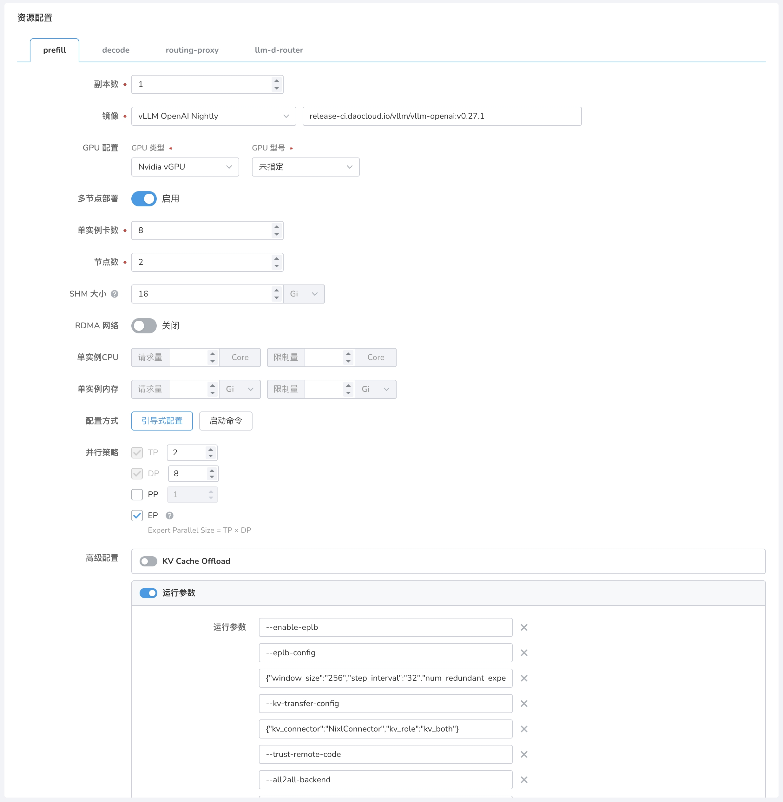

# 使用通用模板部署模型服务

通用模板支持通过可视化表单配置模型、编排框架、推理模式和计算资源，适用于需要根据实际模型、硬件及推理方案自行配置的场景。本文介绍从新建部署到服务验证的操作流程。

## 前提条件

已完成[部署前准备](prerequisites.md)，并确认：

- 目标集群已安装推理加速服务的系统组件。

- GPU、CPU、内存及命名空间配额满足部署要求。

- 模型权重已存放在目标命名空间的 PVC 中。

- 已准备支持目标模型和硬件的推理镜像，节点可以拉取。

- 使用多节点部署或 PD 分离时，网络和存储条件满足部署方案要求。

## 新建部署

1. 进入推理加速服务 -> 模型服务页面，点击 **新建部署** 按钮。

2. 在部署方式中选择「通用模板」。

3. 选择目标集群和命名空间。

也可以在选择优选模板后，选择与目标模型、GPU型号、部署方式相近的模板，点击 **复制当前模版参数至通用模版** 按钮，进入通用模板配置。该方式保留模板的预填信息，便于在已有配置基础上调整。

### 配置模型信息

|**配置项**|**填写说明**|
|---|---|
|服务名称|填写本次部署的模型服务名称，用于在平台中识别服务实例。|
|别名|可选，填写便于识别的服务说明。|
|模型来源|选择 PVC。|
|模型访问名称|填写调用接口时使用的模型 ID，建议与模型官方名称一致。|
|PVC 名称|选择存放模型权重的 PVC；新建 PVC 后可点击刷新按钮更新列表。|
|模型子路径|填写 PVC 内的实际模型目录；权重位于根目录时留空。|
|挂载路径|默认使用页面展示的路径 /mnt/data。|

服务名称与模型访问名称用途不同。例如，服务名称可以为 `glm53-pd`，模型访问名称可以为 `glm-5.3`。后续调用应使用服务详情展示的实际模型 ID。

### 选择编排框架和推理模式

在「推理模式」区域选择编排框架及推理模式：

- **编排框架**：选择 `llm-d` 或 `dynamo`，应与已准备的系统组件和推理方案匹配。

- **PD 一体**：同一实例处理预填充与解码。

- **PD 分离**：分别配置 Prefill 和 Decode 计算实例。

不同组合对应的资源配置角色如下。

|**编排框架**|**推理模式**|**需配置的服务角色**|
|---|---|---|
|llm-d|PD 一体|- Model-server：同时负责预填充和解码，处理输入并逐步生成输出 Token。 - llm-d router：负责推理请求的路由与调度。|
|llm-d|PD 分离|- prefill：负责预填充阶段，处理输入并生成 KV Cache。 - decode：负责解码阶段，逐步生成输出 Token。 - routing-proxy：协调 Prefill 与 Decode 的请求衔接，随 decode 实例部署。 - llm\-d\-router：负责推理请求的路由与调度。|
|dynamo|PD 一体|- worker pool：同时负责预填充和解码，处理输入并逐步生成输出 Token。 - frontend：提供统一请求入口，负责请求分发与推理结果返回。|
|dynamo|PD 分离|- prefill：负责预填充阶段，处理输入并生成 KV Cache。 - decode：负责解码阶段，逐步生成输出 Token。 - frontend：提供统一请求入口，负责请求分发、Prefill 与 Decode 阶段的协调及推理结果返回。|

选择后核对页面展示的部署清单，并依次完成各角色配置。

### 配置各角色资源

在 **资源配置** 中切换角色标签，分别完成各角色的配置。不同角色的配置字段因任务类型而异，以页面实际展示为准。

承担推理任务的角色配置较为复杂，直接影响服务性能与稳定性，请仔细核对各项参数。

|**配置项**|**填写说明**|
|---|---|
|副本数|配置当前角色的资源副本数量。|
|镜像|选择预置镜像，或填写自定义镜像地址。|
|GPU 类型及型号|按实际硬件和部署方案选择。|
|多节点部署|需要一个推理实例跨节点运行时开启，并配置节点数及单实例（单机）卡数。|
|单实例卡数|配置一个计算实例使用的 GPU 数量。如开启多机部署，此处填写每台服务器（每个实例）的 GPU 卡数。|
|SHM 大小|设置容器内共享内存的容量上限，用于推理进程间通信。|
|RDMA 网络|根据部署方案开启；开启后填写实际网络资源名称及请求量。|
|单实例 CPU / 内存|配置 CPU 和内存的请求量和限制量。|

### 配置推理参数

承担推理任务的角色下，还需要配置并行参数等相关推理参数，选择 **引导式配置** 或 **启动命令**。

#### 引导式配置

- **并行策略配置**

通过表单配置页面提供的并行策略及相关参数：

|**参数**|**说明**|
|---|---|
|TP|张量并行，将模型计算拆分到多个设备。|
|DP|数据并行，配置并行处理请求的计算组。|
|PP|流水线并行，将模型按阶段拆分。|
|EP|专家并行，适用于支持该方式的 MoE 模型及引擎。EP 并行数 = TP × DP|

参数应与模型架构、推理引擎版本和 GPU 分配相匹配。开启并行选项不会自动增加已申请的 GPU 资源，请确认 TP * DP * PP 数量与每副本 GPU 卡数相等，如开启多机部署，则应与单实例卡数 * 节点数相等。

- **KV Cache Offload**

需要使用 KV Cache 卸载时，展开该选项并开启，填写实际 Redis 实例 URL 地址及每卡本地缓存容量。

每卡本地缓存容量乘以单实例卡数，应小于单实例内存，并为推理进程预留足够空间。

- **运行参数**

可逐项填写必要的推理运行参数，如 `max-model-len` `kv-cache-dtype`等。

- **环境变量**

根据镜像要求添加环境变量，引用 Secret、ConfigMap 等资源。

- **健康检查**

按需配置存活、就绪和启动检查，核对检查方式、端口、路径、周期及超时时间。

模型首次加载可能耗时较长，应为启动检查预留足够时间，避免加载期间被反复重启。

#### 启动命令

使用启动命令配置时，填写所选推理框架与引擎版本支持的完整启动方式。

环境变量和健康检查的配置同 **引导式配置**。

填写后可通过 **预览 YAML** 核对最终生成的整体配置。

### 预览并部署

1. 点击“预览 YAML”，核对服务配置，确认无误后点击“提交并部署”按钮。

2. 返回模型服务列表，点击服务卡片进入新服务详情，查看各角色的就绪情况。

### 验证服务

1. 在“拓扑与配置”中确认各角色的配置符合预期。

2. 在“资源列表”中按角色查看资源部署状态；部署过程中可查看 Pod 日志或跳转容器管理页面进行排查。

3. 服务正常运行后，可在详情页“服务观测”页面查看服务监控。

**完成标准**：服务状态变更为“可用”，各角色下的资源达到“运行中”状态。
