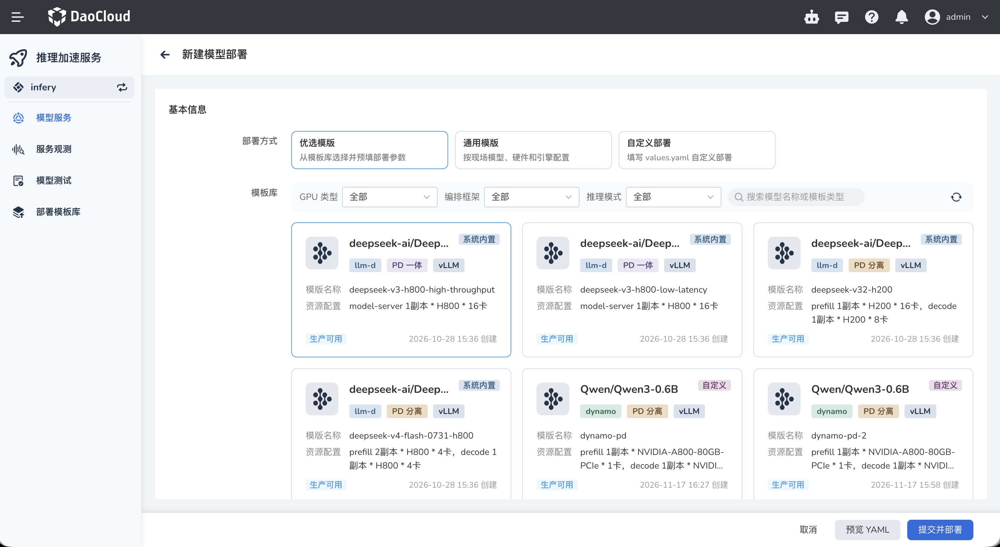

---
hide:
  - toc
---

# 使用优选模板部署模型

优选模板针对特定模型、GPU 和推理引擎组合，预先配置编排框架、推理模式和推理参数，帮助您快速创建模型服务。

## 前提条件

已完成[部署前准备](prerequisites.md)，并确认：

- 已准备模型文件，当前工作空间可以访问模型权重。
- 目标集群的 GPU 资源满足模板要求。
- 已具备目标集群和命名空间的操作权限。

## 操作步骤

1. 从左侧导航栏进入 **推理加速服务** > **模型服务**，点击 **新建部署**。

2. 在 **部署方式** 中选择 **优选模板**。根据目标模型和 GPU 资源筛选模板，选择匹配的模板卡片。

    

    | 模板信息 | 选择依据 |
    | --- | --- |
    | 适用模型 | 核对卡片上的模型名称和版本是否与已有权重一致。 |
    | 编排框架与推理模式 | 按部署方案选择 llm-d 或 Dynamo，以及 PD 分离或 PD 一体。 |
    | GPU 要求 | 核对 GPU 型号、显存和数量，确认集群可满足所选模板的资源要求。 |
    | 模板说明 | 将鼠标悬停在模板卡片上，核对模板说明中的推理引擎版本及其他适用条件。 |

3. 选择 **目标集群** 和 **命名空间**，填写基本信息。

    | 配置项 | 填写说明 | 建议值或示例 |
    | --- | --- | --- |
    | 服务名称 | 在平台中识别本次部署的模型服务。 | `glm53-pd` |
    | 别名 | 可选，填写便于识别的服务说明。 | GLM 5.3 PD 分离服务 |
    | 模型来源 | 选择模型权重的来源。 | PVC |
    | 模型访问名称 | 填写调用接口时使用的模型 ID。 | 如 `glm-5.3`，调用时以服务详情为准。 |
    | PVC 名称 | 选择目标命名空间中存放模型权重的 PVC。 | 选择与模板对应的权重 PVC。新建后可点击刷新按钮更新列表。 |
    | 模型子路径 | 填写 PVC 内的模型目录。 | 使用实际目录。权重位于 PVC 根目录时留空。 |
    | 挂载路径 | 使用页面展示的容器挂载路径。 | 默认 `/mnt/data`。 |

4. 在 **资源配置** 中切换角色标签。编排框架和推理模式由模板决定。GPU 卡数、并行策略及推理参数按模板预填，您只需按现场实际环境调整页面允许编辑的字段，字段填写说明参见[通用模板部署的资源配置步骤](generic-template.md#configure-resources)。

5. 点击 **预览 YAML**，核对服务配置后点击 **提交并部署**。

6. 返回 **模型服务** 列表，确认服务状态为 **可用**，资源运行状态为 **运行中**。进入服务详情，核对 **拓扑与配置** 中的角色和配置，以及 **资源列表** 中各角色的就绪情况。服务运行后，可在 **服务观测** 中查看指标。页面位置和状态示例参见[通用模板部署的服务验证步骤](generic-template.md#verify-service)。
