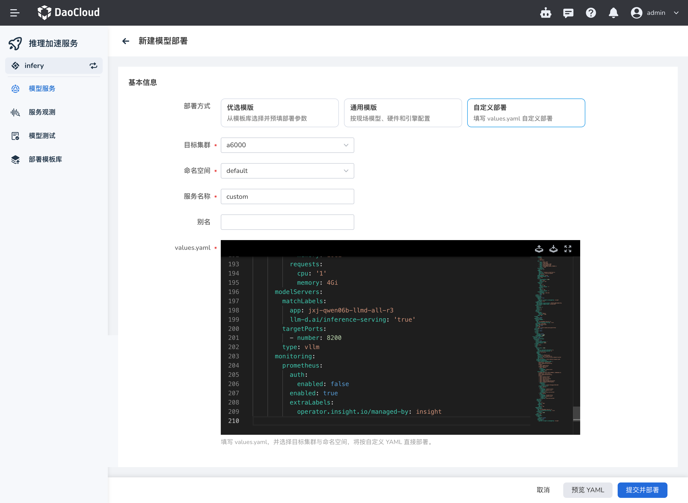

---
hide:
  - toc
---

# 自定义部署

自定义部署适用于需要完全掌控部署配置的场景：填写与平台 Helm Chart 匹配的 `values.yaml`，直接声明编排框架、服务角色与推理参数，平台按该 YAML 原样部署。适合自动化运维（GitOps、CI 流水线）或需要将服务配置纳入代码管理的场景。

## 前提条件

已完成[部署前准备](prerequisites.md)，并确认：

- 已具备目标集群和命名空间的操作权限。
- 所用 `values.yaml` 与平台当前版本的 Helm Chart 结构匹配。
- 模型权重已存放在目标命名空间的 PVC 中，对应 YAML 中的 `modelArtifacts.uri`。

## 操作步骤

1. 从左侧导航栏进入 **推理加速服务** > **模型服务**，点击 **新建部署**。

2. 在 **部署方式** 中选择 **自定义部署**（填写 `values.yaml` 自定义部署）。

3. 选择 **目标集群** 和 **命名空间**，填写 **服务名称**，**别名** 可选。

4. 编辑 **values.yaml** 。参见 [values.yaml 示例](#custom-values-example)。

    

    填写 `values.yaml` 并选择目标集群与命名空间后，将按自定义 YAML 直接部署。

5. 点击 **预览 YAML** ，核对服务配置后点击 **提交并部署** 。

6. **验证服务**。

    返回 **模型服务** 列表，确认服务状态为 **可用**，资源运行状态为 **运行中**。页面位置和状态示例参见[通用模板部署的服务验证步骤](generic-template.md#verify-service)。

## 关键配置说明

下例使用 llm-d 编排框架部署 Qwen3-0.6B 模型（vLLM 引擎、PD 一体、单卡 A800）。YAML 的顶层配置段与关键配置项如下：

| 顶层配置段 | 作用 |
| --- | --- |
| `dynamo` | Dynamo 编排框架开关。示例中 `enabled: false`，表示不启用 Dynamo。 |
| `llm-d-infra` | llm-d 基础设施组件（推理网关）。示例中 `enabled: true`。 |
| `llm-d-modelservice` | 推理服务主体：服务角色、模型挂载、并行策略与路由配置。 |
| `llm-d-router-gateway` | llm-d 路由与网关：请求入口、EndpointPicker 调度配置与监控。 |

| 配置项 | 说明 |
| --- | --- |
| `accelerator` | 加速卡类型 `type` 及对应资源名称，如 `nvidia` 对应 `nvidia.com/gpu`；国产算力卡对应 `huawei`、`intel-gaudi` 等条目。 |
| `decode` / `prefill` / `encode` | 服务角色，`create` 控制是否部署。示例中仅 `decode` 启用，即 PD 一体模式；PD 分离时需同时启用 `prefill`。 |
| `containers.args` | 推理引擎启动参数，如 `--tensor-parallel-size`、`--max-model-len`、`--gpu-memory-utilization` 等。 |
| `containers.image` | 推理镜像的 `registry` / `repository` / `tag`，使用自定义镜像时同步修改。 |
| `modelArtifacts` | 模型来源：`uri: pvc://<PVC 名称>/` 指定权重所在的 PVC，`mountPath` 为容器内挂载路径，`name` 为模型访问名称。 |
| `nodeSelector` | 按 GPU 型号和厂商选择节点，如 `node.kpanda.io/gpu-product`。 |
| `parallelism` | 并行策略：`tensor`（TP）、`data`（DP）、`workers`，取值需与该角色申请的 GPU 数量一致。 |
| `resources` | 各角色的 CPU、内存、GPU 请求量（`requests`）与限制量（`limits`）。 |
| `routing` | 服务端口与路由代理。`proxy.enabled` 启用后由 `routing-proxy` 协调 prefill 与 decode 的请求衔接，PD 分离场景需开启。 |
| `pluginsCustomConfig` | llm-d EndpointPicker 调度插件配置。示例内置默认调度配置与 PD 分离场景的 `pd-config.yaml`，按实际推理模式取舍。 |

配置时的注意事项与[通用模板](generic-template.md)一致：

- 核对 `parallelism` 与该角色申请的 GPU 总数一致，开启并行选项不会自动增加已申请的 GPU 资源。
- 按实际镜像中的引擎版本核对启动参数的取值和格式，并在 YAML 预览中复核生成的配置。
- 模型首次加载可能耗时较长，应为启动检查预留足够时间。

## 完整 values.yaml 示例 {:#custom-values-example}

<details>
<summary>展开查看完整 values.yaml 示例（llm-d，PD 一体，Qwen3-0.6B）</summary>

```yaml title="values.yaml"
dynamo:
  enabled: false
extraObjects: []
llm-d-infra:
  enabled: true
  llm-d-infra:
    gateway:
      fullnameOverride: ''
      gatewayClassName: istio
      gatewayParameters:
        replicas: 2
      nameOverride: inference-gateway
llm-d-modelservice:
  enabled: true
  llm-d-modelservice:
    accelerator:
      dra: false
      resources:
        amd: amd.com/gpu
        google: google.com/tpu
        hami: nvidia.com/vgpu
        huawei: huawei.com/npu
        intel-gaudi: habana.ai/gaudi
        intel-i915: gpu.intel.com/i915
        intel-xe: gpu.intel.com/xe
        nvidia: nvidia.com/gpu
      type: nvidia
    decode:
      containers:
        - args:
            - --tensor-parallel-size
            - '1'
            - --data-parallel-size
            - '1'
            - --served-model-name
            - Qwen/Qwen3-0.6B
            - --port
            - '8200'
            - --dtype
            - bfloat16
            - --gpu-memory-utilization
            - '0.3'
            - --max-model-len
            - '4096'
            - --max-num-batched-tokens
            - '4096'
            - --max-num-seqs
            - '8'
          command:
            - vllm
            - serve
            - /mnt/data
          env:
            - name: MODEL_PATH
              value: /mnt/data
            - name: ACCESS_MODEL_NAME
              value: Qwen/Qwen3-0.6B
            - name: VLLM_ENGINE_READY_TIMEOUT_S
              value: '1200'
          extraConfig:
            envFrom: []
          image:
            digest: ''
            registry: release-ci.daocloud.io
            repository: vllm/vllm-openai
            tag: v0.27.1
          modelCommand: custom
          mountModelVolume: true
          name: vllm
          ports:
            - containerPort: 8200
              name: http
              protocol: TCP
          resources:
            limits:
              cpu: '2'
              memory: 8Gi
              nvidia.com/gpu: '1'
            requests:
              cpu: '1'
              memory: 4Gi
              nvidia.com/gpu: '1'
          volumeMounts:
            - mountPath: /dev/shm
              name: shm
      create: true
      monitoring:
        podmonitor:
          enabled: true
          labels:
            operator.insight.io/managed-by: insight
          portName: http
      nodeSelector:
        node.kpanda.io/gpu-product: NVIDIA-A800-80GB-PCIe
        node.kpanda.io/gpu-vendor: Nvidia-GPU
      parallelism:
        data: 1
        dataLocal: 1
        tensor: 1
        workers: 1
      replicas: 1
      volumes:
        - emptyDir:
            medium: Memory
            sizeLimit: 16Gi
          name: shm
    encode:
      create: false
    modelArtifacts:
      authSecretName: ''
      labels:
        app: jxj-qwen06b-llmd-all-r3
        llm-d.ai/inference-serving: 'true'
      mountPath: /mnt/data
      name: Qwen/Qwen3-0.6B
      readOnly: true
      size: 5Mi
      uri: pvc://inferx-modelcache-qwen3-0-6b/
    multinode: true
    prefill:
      create: false
    routing:
      proxy:
        enabled: false
        targetPort: 8200
      servicePort: 8000
llm-d-router-gateway:
  enabled: true
  llm-d-router-gateway:
    httpRoute:
      create: true
      inferenceGatewayName: ''
      requestTimeout: 1800s
    provider:
      name: istio
    router:
      epp:
        extProcPort: 9002
        flags:
          metrics-staleness-threshold: 5s
          refresh-metrics-interval: 1s
        haMode: all-active
        image:
          digest: ''
          pullPolicy: IfNotPresent
          registry: ghcr.m.daocloud.io
          repository: llm-d/llm-d-router-endpoint-picker
          tag: v1.0.0
        pluginsConfigFile: inferx-default-plugins.yaml
        pluginsCustomConfig:
          inferx-default-plugins.yaml: |
            apiVersion: llm-d.ai/v1
            kind: EndpointPickerConfig
            plugins:
            - type: queue-scorer
            schedulingProfiles:
            - name: default
              plugins:
              - pluginRef: queue-scorer
                weight: 1.0
          pd-config.yaml: |
            # ALWAYS DO PD IN THIS EXAMPLE (THRESHOLD 0)
            apiVersion: llm-d.ai/v1
            kind: EndpointPickerConfig
            plugins:
            - type: prefill-filter
            - type: decode-filter
            - type: max-score-picker
            - type: queue-scorer
            - type: always-disagg-pd-decider
            - type: disagg-profile-handler
              parameters:
                deciders:
                  prefill: always-disagg-pd-decider
            schedulingProfiles:
            - name: prefill
              plugins:
              - pluginRef: prefill-filter
              - pluginRef: queue-scorer
                weight: 1.0
              - pluginRef: max-score-picker
            - name: decode
              plugins:
              - pluginRef: decode-filter
              - pluginRef: queue-scorer
                weight: 1.0
              - pluginRef: max-score-picker
        replicas: 1
        resources:
          limits:
            cpu: '4'
            memory: 10Gi
          requests:
            cpu: '1'
            memory: 4Gi
      modelServers:
        matchLabels:
          app: jxj-qwen06b-llmd-all-r3
          llm-d.ai/inference-serving: 'true'
        targetPorts:
          - number: 8200
        type: vllm
      monitoring:
        prometheus:
          auth:
            enabled: false
          enabled: true
          extraLabels:
            operator.insight.io/managed-by: insight
```

</details>
