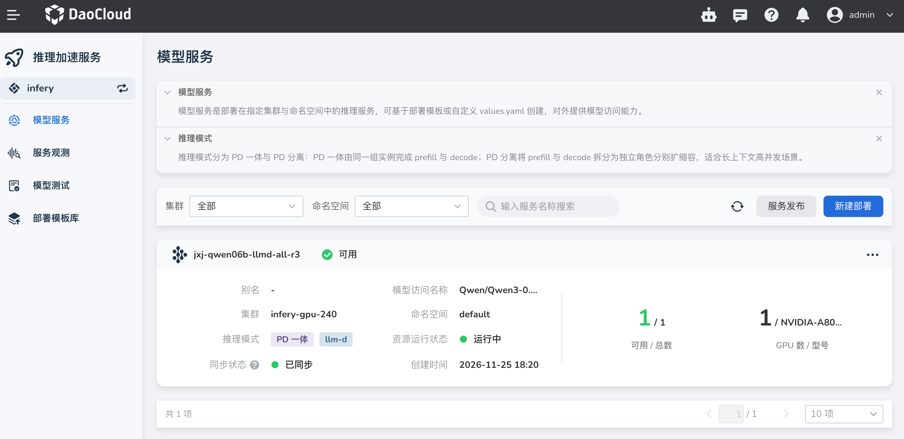

---
hide:
  - toc
---

# 模型服务

模型服务是推理加速服务的核心使用场景：将模型权重与推理引擎、GPU 资源组合，在 Kubernetes 集群中部署为可对外提供 API 的在线推理服务。本文介绍模型服务的基本概念和部署价值，并给出部署路径的总体指引。

## 什么是模型服务

模型服务（Model Service）是部署在指定集群与命名空间中的推理服务：以模型为单位，基于部署模板或自定义 `values.yaml` 创建，对外提供模型访问能力。一个模型服务由一个或多个 **服务角色** 组成，各角色协同完成从接收请求到返回推理结果的完整流程：

- **推理角色**：加载模型权重，执行预填充（Prefill）和解码（Decode）等推理计算，是消耗 GPU 资源的主体。
- **路由角色**：如 `llm-d-router`、`frontend` 等，提供统一的请求入口，负责分发请求、衔接各推理阶段并返回结果。

部署时，平台将模型权重从 PVC 挂载到推理实例，运行所选推理引擎（如 vLLM）完成服务构建。服务就绪后，通过部署时填写的 **模型访问名称** 调用推理接口，供 Knoway、Hydra 等模型服务入口或 Agent、RAG 等业务应用集成。

在 **模型服务** 列表页中，每个服务以卡片形式展示别名、所在集群与命名空间、推理模式、资源运行状态、GPU 数量与型号等关键信息：

平台目前支持两种高性能编排框架及其推理模式，可在部署时按场景选择：

| 编排框架 | 推理模式 | 适用场景 |
| --- | --- | --- |
| llm-d 或 Dynamo | PD 一体 | 预填充（prefill）和解码（decode）由同一实例完成，架构简单，适合中小规模部署。 |
| llm-d 或 Dynamo | PD 分离 | 预填充和解码拆分为独立角色，分别扩缩容，适合长上下文、高并发场景。 |

## 为什么需要部署模型服务

直接持有模型权重并不能对外提供推理能力，需要将其转化为在线服务：

| 原因 | 说明 |
| --- | --- |
| 权重需要推理引擎运行 | 模型权重只是静态文件，必须由推理引擎加载并配合 GPU 计算资源，才能响应推理请求。 |
| 生产场景对性能和稳定性要求高 | 裸启动的推理进程难以应对高并发和长上下文负载。平台通过 PD 分离、KV Cache 卸载、多机多卡等架构优化吞吐与延迟，并以服务观测持续保障运行质量。 |
| 运维复杂度需要平台屏蔽 | 多角色编排、GPU 调度、RDMA 网络、并行策略（TP/DP/PP/EP）等配置在原生 Kubernetes 中门槛较高，平台以模板和表单将这些配置产品化，降低部署与维护成本。 |
| 业务需要标准化的接入方式 | 模型服务就绪后即可被统一接入和管理，避免各业务自行搭建推理环境造成的资源浪费和口径不一。 |

## 部署路径

部署一个模型服务通常经过以下几步：

1. **完成[部署前准备](prerequisites.md)**：确认权限、集群组件、GPU 资源、推理镜像，并将模型权重存放到 PVC。
2. **选择部署方式**：从左侧导航栏进入 **推理加速服务** > **模型服务** ，点击 **新建部署** ，然后按场景选择：

    - [优选模板](optimized-template.md)：平台针对特定模型、GPU 和推理引擎组合的预配置模板，标记为 **生产可用** 的模板已通过真实环境验证，适合快速部署。
    - [通用模板](generic-template.md)：按实际模型、硬件和推理引擎自行配置资源与推理参数，适合没有完全匹配模板的场景。
    - [自定义部署](custom.md)：使用与平台 Helm Chart 匹配的 `values.yaml` 部署，适合自动化运维场景。

3. **验证服务**：返回模型服务列表，确认服务状态为 **可用**、资源运行状态为 **运行中**；点击服务卡片进入详情，核对各角色的拓扑与资源配置，并通过服务观测查看健康实例数和吞吐等指标。

上述两种模板的资源配置和推理参数口径一致，优选模板本质上是预填了这些参数的通用模板。没有完全匹配的模板时，可将相近模板的参数复制到通用模板中调整后部署。
