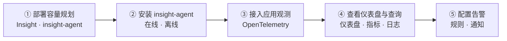

---
hide:
  - toc
---

# 什么是可观测模块

可观测模块 (Insight) 是以应用为中心、开箱即用的新一代云原生可观测性平台。
能够实时监控应用及资源，采集各项指标、日志及事件等数据用来分析应用健康状态，不仅提供告警能力以及全面、清晰、多维度数据可视化能力，兼容主流开源组件，而且提供快捷故障定位及一键监控诊断的能力。
可观测模块实现了指标、日志、链路的统一采集，支持对指标、日志进行多维度的告警并提供简洁明了的可视化管理界面。

## 核心能力

- :material-monitor-dashboard:{ .lg .middle } __仪表盘__

    ---

    基于原生 Grafana 提供内置仪表盘，覆盖平台组件、集群资源与核心组件监控，支持导入自定义模板。

    [:arrow_forward: 查看仪表盘](../user-guide/dashboard/dashboard.md)

- :material-server:{ .lg .middle } __基础设施监控__

    ---

    多集群集中观测，覆盖集群、节点、命名空间、容器等维度，支持事件查询与黑盒拨测。

    [:arrow_forward: 集群监控](../user-guide/infra/cluster.md)

- :material-chart-line:{ .lg .middle } __指标与日志查询__

    ---

    指标支持普通查询与 PromQL 高级查询；日志支持关键字检索、Lucene 语法、上下文查看与下载。

    [:arrow_forward: 指标查询](../user-guide/data-query/metric.md)

- :material-transit-connection-variant:{ .lg .middle } __链路追踪__

    ---

    基于 OpenTelemetry 采集调用链，提供服务拓扑、服务列表与调用链分析，快速定位故障。

    [:arrow_forward: 调用链](../user-guide/trace/trace.md)

- :material-bell-outline:{ .lg .middle } __告警中心__

    ---

    内置 100+ 告警规则，支持 PromQL 自定义规则、消息模板、静默与抑制，通过邮件、企业微信、钉钉等多渠道通知。

    [:arrow_forward: 告警中心](../user-guide/alert-center/index.md)

- :material-cog-outline:{ .lg .middle } __采集管理与系统配置__

    ---

    管理 insight-agent 与指标、日志采集任务，自定义指标、日志、链路数据的保存时长。

    [:arrow_forward: 日志采集和查询](../user-guide/collection-manag/collection-manag.md)
    [:arrow_forward: 系统配置与保存时长](../user-guide/system-config/index.md)

## 使用流程

使用可观测模块通常分为 **部署接入** 与 **观测告警** 两个阶段：管理员先规划资源并安装 insight-agent，业务用户随后接入应用观测、查看仪表盘与查询数据，并配置告警及时感知异常。

| 步骤 | 角色 | 说明 |
| --- | --- | --- |
| ① [部署容量规划](../quickstart/res-plan/index.md) | 平台管理员 | 评估 Insight 与 insight-agent 所需的节点与存储资源 |
| ② [安装 insight-agent](../quickstart/install/install-agent.md) | 平台管理员 | 在被观测集群在线或离线安装采集组件，并可按需升级 |
| ③ [接入应用观测](../quickstart/otel/otel.md) | 业务用户 | 通过 OpenTelemetry（无侵入 Operator 或 SDK）采集链路与指标 |
| ④ [查看仪表盘与查询](../user-guide/dashboard/dashboard.md) | 业务用户 | 通过仪表盘、指标与日志查询掌握应用与集群运行状态 |
| ⑤ [配置告警](../user-guide/alert-center/alert-policy.md) | 平台管理员 | 创建告警规则与通知配置，及时感知异常 |

## 快速上手

  <a class="insight-path-step" style="--path-c:#2196f3" href="../quickstart/res-plan/">
    1
    资源规划
    评估节点与存储资源
    Go →
  </a>
  <a class="insight-path-step" style="--path-c:#00acc1" href="../quickstart/install/install-agent/">
    2
    安装 insight-agent
    在线 · 离线安装采集组件
    Go →
  </a>
  <a class="insight-path-step" style="--path-c:#43a047" href="../quickstart/otel/otel/">
    3
    接入应用观测
    OpenTelemetry 无侵入
    Go →
  </a>
  <a class="insight-path-step" style="--path-c:#fb8c00" href="../user-guide/dashboard/dashboard/">
    4
    查看仪表盘
    指标 · 日志 · 链路
    Go →
  </a>

## 基本概念

可观测性 (Insight) 有关的基本概念如下。

| #    | 术语       | 英文              | 定义                                                         |
| :--- | :--------- | ----------------- | :----------------------------------------------------------- |
| 1    | 监控目标   | Target            | 被监控的对象；系统会定时向监控点发起抓取任务，从中获取指标   |
| 2    | 指标       | Metric            | 使用 [open-metric](https://openmetrics.io/) 格式描述，衡量软件或硬件系统中某种属性的程度的标准 |
| 3    | 自定义指标 | Recording Rule    | 一个被命名的 PromQL 表达式，这是将多个指标通过计算而得到的新指标，用来描述更加完整和复杂的系统状态 |
| 4    | 仪表盘     | Dashboard         | 仪表盘是可视化管理的一种表现形式，即对数据、情报等状况一目了然的表现，它通过形象直观而又色彩适宜的各种视觉感知来展示信息。通过可视化图形展示平台的实时情况和 DCE 中所有的性能指标。 |
| 6    | 服务发现   | Service Discovery | 一个用于 Kubernetes 环境的服务发现配置，用于批量且自动地接入 Kubernetes 上的监控点 |
| 7    | Exporter   | Exporter          | 一个能够提供指标的服务，往往被理解为监控对象                 |
| 8    | 告警规则   | Rule              | 一个返回值是布尔值的 PromQL 表达式，它描述了指标或自定义指标是否处于阈值范围中，如果不满足将产生一条告警事件 |
| 9    | 告警消息   | Alert             | 告警规则被触发时的记录信息，记录了告警规则、触发时间、当前系统状态；同时将触发相应的动作，例如发送邮件 |
| 10   | 通知       | Notification      | 由系统通过邮件等渠道发送给用户的告警事件信息                 |
| 11   | PromQL     | PromQL            | Prometheus 系统所支持的查询语句                              |

## 更多资源

- :material-format-list-bulleted:{ .lg .middle } __功能列表__

    ---

    一览可观测性在仪表盘、基础设施、指标日志、链路追踪与告警中心上的完整功能清单。

    [:arrow_forward: 查看功能列表](features.md)

- :material-map-outline:{ .lg .middle } __应用场景__

    ---

    了解多集群数据统一采集观测、快速故障定位与排查等典型场景。

    [:arrow_forward: 查看应用场景](scenarios.md)

- :material-shield-account-outline:{ .lg .middle } __权限说明__

    ---

    了解使用可观测性模块各功能所需的用户角色与权限。

    [:arrow_forward: 查看权限说明](permission.md)

[下载中心](https://docs.daocloud.io/download/){ .md-button .md-button--primary }
[了解 Token 工厂效能平台](https://docs.daocloud.io/tf/){ .md-button .md-button--primary }
[了解 d.run AI 操作系统](https://docs.daocloud.io/drun/){ .md-button .md-button--primary }
[查阅《可观测用户手册》PDF](https://harbor-test2.cn-sh2.ufileos.com/docs/download/docs/insight.pdf){ .md-button .md-button--primary }
