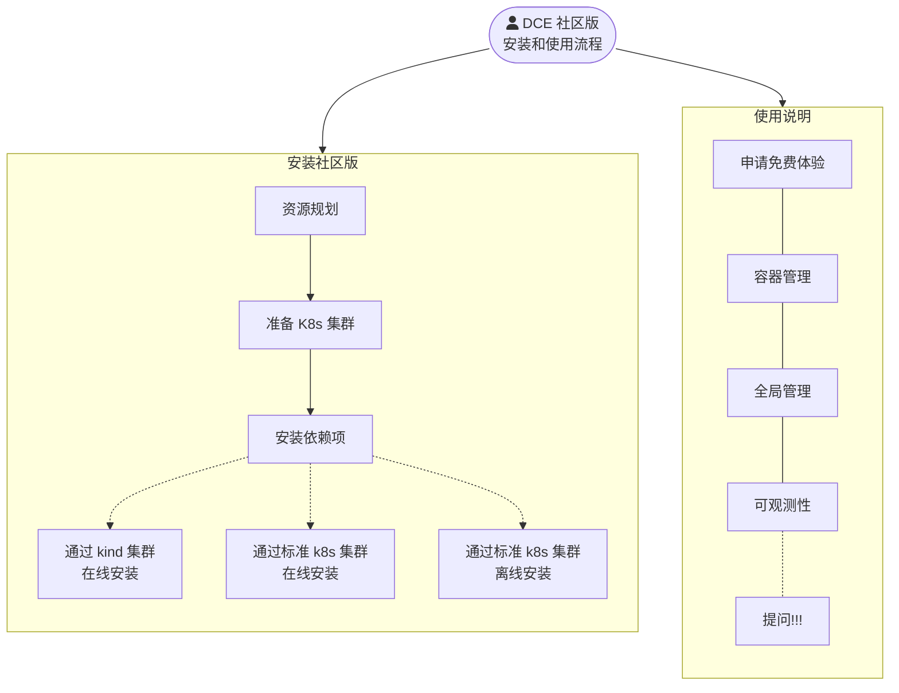
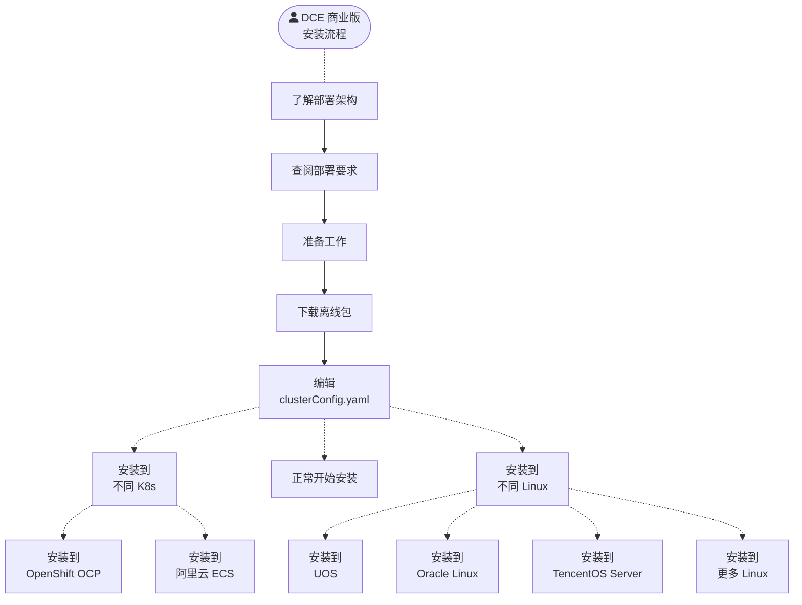

# 安装简介

DCE 分为社区版和商业版。

- 社区版包括容器管理、全局管理、可观测性三大模块，可永久免费使用。[DCE 社区版安装手册 PDF](https://harbor-test2.cn-sh2.ufileos.com/docs/download/docs/dce5-community.pdf){ .md-button }
- 商业版在社区版的基础上可按需增加服务网格、微服务引擎、多云编排、数据服务中间件、镜像仓库、云边协同、容器化虚拟机等模块，
  功能更全面，更能适应各类生产环境需求。[DCE 商业版安装手册 PDF](https://harbor-test2.cn-sh2.ufileos.com/docs/download/docs/dce5.0-install.pdf){ .md-button }

<table>
  <thead>
    <tr>
      <th>版本</th>
      <th>包含的模块</th>
      <th>描述</th>
    </tr>
  </thead>
  <tbody>
    <tr>
      <td>社区版</td>
      <td>
        <ul>
          <li><a href="../ghippo/intro/">全局管理</a></li>
          <li><a href="../kpanda/intro/">容器管理</a></li>
          <li><a href="../insight/intro/">可观测性</a></li>
        </ul>
      </td>
      <td>
        <a href="../dce/license0/">永久免费授权</a>，3 个模块会保持持续更新，可随时
        <a href="https://docs.daocloud.io/download/#_3">下载子模块的离线包</a>
      </td>
    </tr>
    <tr>
      <td>商业版</td>
      <td>
社区版上增加：

        <ul>
          <li><a href="../amamba/intro/">应用工作台</a></li>
          <li><a href="../kairship/intro/">多云编排</a></li>
          <li><a href="../skoala/intro/">微服务引擎</a></li>
          <li><a href="../mspider/intro/">服务网格</a></li>
          <li><a href="../middleware/">精选中间件</a></li>
          <li><a href="../kangaroo/intro/">镜像仓库</a></li>
          <li><a href="../kant/intro/">云边协同</a></li>
          <li><a href="../virtnest/intro/">虚拟机</a></li>
          <li><a href="../topohub/intro/">设备管理</a></li>
          <li><a href="../network/intro/">云原生网络</a></li>
          <li><a href="../storage/hwameistor/intro/">云原生存储</a></li>
        </ul>
      </td>
      <td>
        联系我们授权：电邮 info@daocloud.io 或致电 400 002 6898，各个模块可按需自由组合，
        可随时<a href="https://docs.daocloud.io/download/#_3">下载子模块的离线包</a>
      </td>
    </tr>
  </tbody>
</table>

## 社区版安装流程

DCE 社区版的安装流程如下图：

## 商业版安装流程

DCE 商业版的安装流程如下图：

## 联系我们

DCE 的安装流程可能会有变更。请收藏此页，关注更新动态，更多操作文档也在制作之中。

- 若有任何安装或使用问题，请[提出反馈](https://github.com/DaoCloud/DaoCloud-docs/issues)。
- 欢迎扫描二维码，与开发者畅快交流：

    

[下载中心](https://docs.daocloud.io/download/){ .md-button }
[了解 Token 工厂效能平台](https://docs.daocloud.io/tf/){ .md-button }
[了解 d.run AI 操作系统](https://docs.daocloud.io/drun/){ .md-button }
