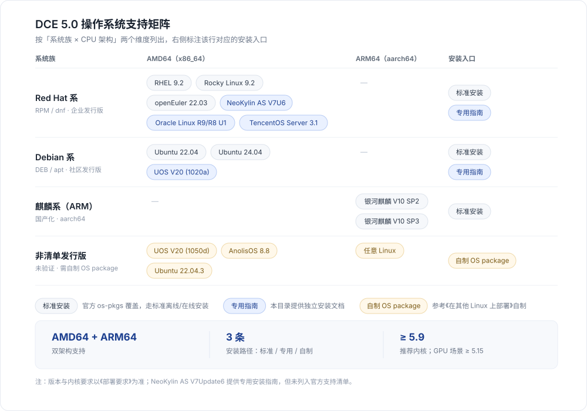
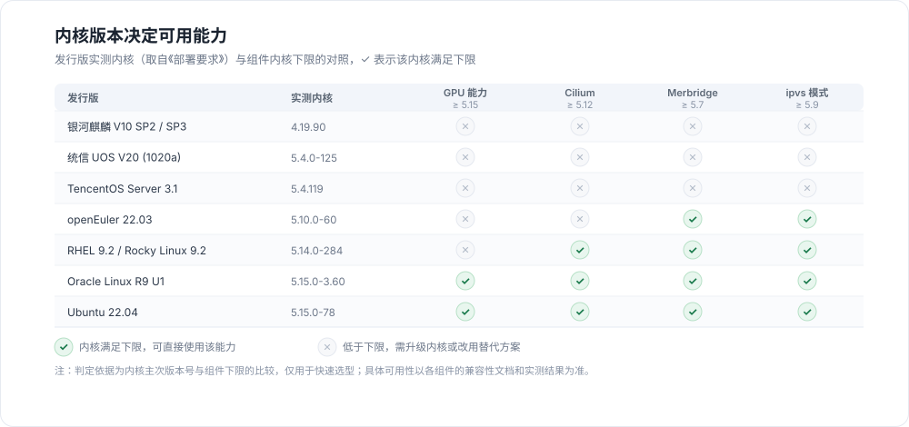

# 操作系统支持概览

DCE 5.0 由 `dce5-installer` 部署，安装器本身只依赖 Linux 内核、容器运行时和 SSH 等基础能力，不同发行版之间的差异主要体现在 **操作系统离线包（OS package）** 上。
因此可以把支持范围理解为三类：随离线包直接提供的标准安装、需要专用步骤的发行版，以及需要自行制作 OS package 的发行版。

本页汇总 DCE 支持的各款操作系统，并说明每一类该走哪条安装路径。

!!! tip "先看这里"

    - 完整的支持清单，以及内核、硬件、网络、端口的详细要求，以[部署要求](../commercial/deploy-requirements.md)为准，本页只做汇总与索引。
    - 不在清单内的发行版并不等于不能用，可按[在其他 Linux 上部署](otherlinux.md)自制 OS package 后安装。

## 支持矩阵

下图按「系统族 × CPU 架构」两个维度列出已支持的发行版，右侧标注每种情况对应的安装入口。

三种安装入口的含义如下：

- **标准安装**：发行版已随离线包提供 os-pkgs，直接按[安装简介](../index.md)中的商业版流程安装即可。
- **专用指南**：安装器需要额外的前置操作（如准备 ISO、预装依赖），本目录提供独立文档，见下方[专用安装指南](#_4)。
- **自制 OS package**：发行版不在官方清单内，需要先用 kubean 提供的脚本制作 os-pkgs，再开始安装。

## 官方支持清单

下表摘自[部署要求](../commercial/deploy-requirements.md)，即官方已验证与支持的发行版。表中「测试内核」是测试人员实际使用的版本，可作为选型参考。

| 架构 | 操作系统 | 测试内核 | 安装入口 |
| ---- | -------- | -------- | -------- |
| AMD64 | Red Hat Enterprise Linux 9.2 | 5.14.0-284.11.1.el9_2.x86_64 | 标准安装 |
| AMD64 | Rocky Linux 9.2 | 5.14.0-284.11.1.el9_2.x86_64 | 标准安装 |
| AMD64 | Ubuntu 22.04 | 5.15.0-78-generic | 标准安装 |
| AMD64 | Ubuntu 24.04 | / | 标准安装 |
| AMD64 | openEuler 22.03 | 5.10.0-60.18.0.50.oe2203.x86_64 | 标准安装 |
| AMD64 | 统信 UOS V20 (1020a) | 5.4.0-125-generic | [专用指南](uos-v20-install-dce5.0.md) |
| AMD64 | Oracle Linux R9/R8 U1 | 5.15.0-3.60.5.1.el9uek.x86_64 | [专用指南](oracleLinux-install-dce5.0.md) |
| AMD64 | TencentOS Server 3.1 | 5.4.119-19.0009.14 | [专用指南](TencentOS-install-dce5.0.md) |
| AMD64 | NeoKylin Linux Advanced Server V7Update6 | / | [专用指南](neokylin-install-dce5.0.md) |
| ARM64 | 银河麒麟 OS V10 SP2 | 4.19.90-24.4.v2101.ky10.aarch64 | 标准安装 |
| ARM64 | 银河麒麟 OS V10 SP3 | 4.19.90-89.11.v2401.ky10.aarch64 | 标准安装 |

!!! note "关于这张表"

    - 表中内核均为测试人员使用的版本，不是硬性下限，真正的下限见下方[内核要求](#_5)。
    - CentOS 7 已于 2024 年 6 月 30 日结束维护，建议按自身情况替换为 Rocky Linux 9.2、Ubuntu 22.04 等仍受支持的发行版。
    - ARM64 架构目前只有银河麒麟 OS V10 SP2/SP3 进入官方清单；其他 ARM64 发行版请按自制 OS package 的方式评估。

## 专用安装指南

以下几个发行版需要额外的前置步骤，请按对应文档操作：

-   :material-server:{ .lg .middle } __统信 UOS V20 (1020a)__

    ---

    Debian 系，安装器 **v0.6.0** 及更高版本支持。安装前需在火种机器上准备好 `python3.6`，并基于 ISO 制作 os-pkgs。

    [:octicons-arrow-right-24: 在 UOS V20 上部署](uos-v20-install-dce5.0.md)

-   :material-database:{ .lg .middle } __Oracle Linux R9/R8 U1__

    ---

    Red Hat 系，安装器 **v0.8.0** 及更高版本支持。需按 R9/R8 分别下载官方 osPackage 离线包。

    [:octicons-arrow-right-24: 在 Oracle Linux 上部署](oracleLinux-install-dce5.0.md)

-   :material-cloud-outline:{ .lg .middle } __TencentOS Server 3.1__

    ---

    Red Hat 系，安装器 **v0.9.0** 及更高版本支持。需下载 `os-pkgs-tencent31` 离线包。

    [:octicons-arrow-right-24: 在 TencentOS 上部署](TencentOS-install-dce5.0.md)

-   :material-shield-check:{ .lg .middle } __NeoKylin AS V7Update6__

    ---

    Red Hat 系。节点需预装 `iptables`、`iproute`，文档给出了对应的离线 rpm 安装方式。

    [:octicons-arrow-right-24: 在 NeoKylin 上部署](neokylin-install-dce5.0.md)

-   :material-laptop:{ .lg .middle } __其他 Linux__

    ---

    未进入官方清单的发行版，用 kubean 脚本自制 OS package 后安装。已验证 UOS V20 (1050d)、AnolisOS 8.8 GA、Ubuntu 22.04.3。

    [:octicons-arrow-right-24: 在其他 Linux 上部署](otherlinux.md)

## 内核要求

操作系统能否用上某项能力，往往取决于内核版本而不是发行版名称。下表列出各组件的内核下限，可与上表的「测试内核」对照。

| 组件/功能 | 内核要求 |
| --------- | -------- |
| 容器管理 GPU 能力 | ≥ 5.15 |
| Cilium | ≥ 5.12 |
| Merbridge | ≥ 5.7 |
| KubeVirt | > 4.11 |
| HwameiStor DRBD 能力 | 参见 [DRBD 适配的内核版本](../../storage/hwameistor/intro/drbd-support.md) |

!!! warning "内核注意事项"

    - 内核低于 5.9 时，`kube-proxy` 使用 `ipvs` 模式偶现通过 Service 访问集群内服务的 1 秒延时，
      或后端业务升级后访问 Service 失败，详见 Kubernetes 社区 [Issue #81775](https://github.com/kubernetes/kubernetes/issues/81775)。
      可将内核升级到 5.9 及以上，或改用 `iptables` 模式，或调整
      `net.ipv4.vs.conntrack`、`net.ipv4.vs.conn_reuse_mode`、`net.ipv4.vs.expire_nodest_conn` 三个内核参数。
    - Ubuntu 会自动升级内核并可能随之重启，若依赖特定内核版本，建议关闭自动更新以免出现兼容性问题。

## 选型建议

- **要用 GPU 能力**：优先选择实测内核在 5.15 的 Ubuntu 22.04、Oracle Linux R9 U1；RHEL 9.2、Rocky Linux 9.2、openEuler 22.03 需先把内核升级到 5.15 及以上。
- **信创（国产化）环境**：AMD64 可选统信 UOS V20 (1020a)、NeoKylin AS V7Update6；ARM64 目前只有银河麒麟 OS V10 SP2/SP3 在清单内。
- **已有存量发行版**：UOS V20 (1050d)、AnolisOS 8.8 GA、Ubuntu 22.04.3 已经验证可用，但需自制 OS package，见[在其他 Linux 上部署](otherlinux.md)。
- **内核偏旧（4.19 / 5.4）**：可用于基础部署，但 Cilium、Merbridge 以及 GPU 能力会受限，建议提前规划内核升级。

## 延伸阅读

- [部署架构](../commercial/deploy-arch.md)：确认本次部署采用哪种模式
- [部署要求](../commercial/deploy-requirements.md)：硬件、网络、端口与内核的完整要求
- [前置检查](../commercial/prepare.md)：机器资源与部署前检查
- [安装简介](../index.md)：社区版与商业版各自的安装流程
- [在非主流操作系统上创建集群](../../kpanda/best-practice/use-otherlinux-create-custer.md)：集群侧对非清单发行版的处理方式

[下载中心](https://docs.daocloud.io/download/){ .md-button .md-button--primary }
[了解 Token 工厂效能平台](https://docs.daocloud.io/tf/){ .md-button .md-button--primary }
[了解 d.run AI 操作系统](https://docs.daocloud.io/drun/){ .md-button .md-button--primary }
