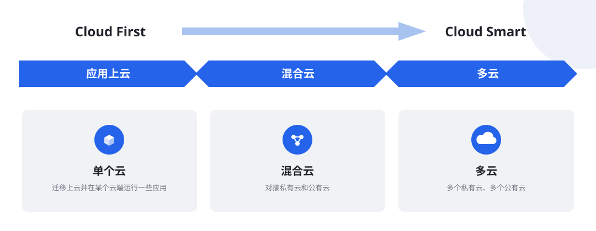

---
hide:
  - toc
---

# 多云编排

多云编排 Kairship（Kubernetes Airship）是一个以应用为中心、开箱即用的多云应用编排平台，
实现多云和混合云环境的集中管理，提供跨云的应用部署、发布和运维能力；
支持基于集群资源的应用弹性扩缩，实现全局负载均衡；
提供故障恢复能力，彻底解决多云应用的灾备问题。
让开发者使用多云像使用一个 Kubernetes 集群：兼容 Kubernetes 原生 API，零改造从单集群升级到多集群，无缝集成现有单集群工具链生态。

## 核心能力

- :material-cloud-plus-outline:{ .lg .middle } __多云应用部署__

    ---

    通过 PropagationPolicy 部署策略定义多集群调度要求，支持 1:N 策略映射与默认策略，将工作负载跨云分发到多个集群。

    [:arrow_forward: 配置部署策略](../policy/propagation.md)

- :material-swap-horizontal:{ .lg .middle } __一键转换__

    ---

    将单云工作负载一键转换为多云工作负载，已有应用零改造迁移到多云环境。

    [:arrow_forward: 一键转换](../workload/promote.md)

- :material-tune:{ .lg .middle } __差异化配置__

    ---

    通过 OverridePolicy 为不同集群自动生成差异化配置，例如按区域适配镜像仓库地址、按云厂商选择存储类。

    [:arrow_forward: 配置差异化策略](../policy/override.md)

- :material-chart-line:{ .lg .middle } __全局弹性伸缩__

    ---

    基于集群资源对应用进行弹性扩缩，支持跨集群 FHPA 弹性伸缩，实现全局负载均衡。

    [:arrow_forward: 跨集群弹性伸缩](../best-practice/fhpa.md)

- :material-cloud-sync-outline:{ .lg .middle } __故障恢复__

    ---

    内置两地三中心、同城双活、异地容灾等面向多场景的策略集，通过故障转移解决多云应用灾备问题。

    [:arrow_forward: 故障转移](../failover/failover.md)

- :material-cube-outline:{ .lg .middle } __多云资源管理__

    ---

    统一管理多云工作负载与 ConfigMap、Secret、Service、Ingress 等资源，支持多云自定义资源（CRD）。

    [:arrow_forward: 创建多云工作负载](../workload/deployment.md)

## 使用流程

使用多云编排通常分为 **环境准备** 与 **应用治理** 两个阶段：管理员先创建多云实例并接入工作集群，业务用户随后创建多云工作负载、配置调度策略，并通过弹性伸缩与故障转移保障应用长期稳定运行。

| 步骤 | 角色 | 说明 |
| --- | --- | --- |
| ① [创建多云实例](../instance/add.md) | 平台管理员 | 创建多云实例，作为多云资源与策略的管理入口 |
| ② [管理工作集群](../cluster.md) | 平台管理员 | 接入或注册成员集群，供多云编排统一调度 |
| ③ [创建多云工作负载](../workload/deployment.md) | 业务用户 | 通过表单或 YAML 创建多云 Deployment，也可将单云应用[一键转换](../workload/promote.md) |
| ④ [配置部署策略](../policy/propagation.md)与[差异化策略](../policy/override.md) | 业务用户 | 定义多集群调度要求，按需为不同集群生成差异化配置 |
| ⑤ [故障转移](../failover/failover.md)与[跨集群弹性伸缩](../best-practice/fhpa.md) | 平台管理员 | 配置 FHPA 应对负载波动，通过故障转移保障业务连续性 |

## 基本概念

| 概念 | 描述 |
|-----| -----|
| 资源模板 | 多云编排软件使用 Kubernetes 原生 API 定义联合资源模板，以便轻松与现有 Kubernetes 采用的工具进行集成。 |
| 部署策略 | 多云编排软件提供了一个独立的 PropagationPolicy API 来定义多集群的调度要求。 |
| | - 支持 1:N 的策略映射机制。用户无需每次创建联合应用时都标明调度约束。 |
| | - 使用默认策略，用户可以直接与 Kubernetes API 交互。 |
| 差异化策略 | 多云编排软件为不同的集群提供了一个可自动化生产独立配置的 OverridePolicy API。 |
| | - 基于成员集群所在区域自动配置不同镜像仓库地址。 |
| | - 根据集群不同的云厂商，可以使用不同的存储类。 |

## 产品优势

让开发者使用多云像使用一个 Kubernetes 集群，多云编排具有以下优势：

| 优势 | 说明 |
| ---- | ---- |
| 兼容 Kubernetes 原生 API | 零改造从单集群升级到多集群 |
| 无缝集成 Kubernetes 单集群工具链生态 | 告别绑定：支持多云平台，自动分配，自由迁移；不绑定厂商的商业产品 |
| 丰富的多集群调度 | 集群亲和性调度，多颗粒多集群高可用部署；支持多区域（region）、多可用区、多集群、多供应商 |
| 开放中立 | 来自互联网、金融、制造业、运营商、云厂商等联合发起；开箱即用：面向多场景的内置策略集——两地三中心、同城双活、异地容灾 |
| 集中式管理 | 无需顾虑集群位置；支持公有云、私有云、边缘等集群 |

## 快速上手

  <a class="kairship-path-step" style="--path-c:#2196f3" href="../instance/add/">
    1
    创建多云实例
    多云资源管理入口
    Go →
  </a>
  <a class="kairship-path-step" style="--path-c:#00acc1" href="../cluster/">
    2
    接入工作集群
    纳管已有 Kubernetes 集群
    Go →
  </a>
  <a class="kairship-path-step" style="--path-c:#43a047" href="../workload/deployment/">
    3
    创建多云工作负载
    表单 · YAML · 一键转换
    Go →
  </a>
  <a class="kairship-path-step" style="--path-c:#fb8c00" href="../policy/propagation/">
    4
    配置调度策略
    PropagationPolicy · OverridePolicy
    Go →
  </a>
  <a class="kairship-path-step" style="--path-c:#8e24aa" href="../failover/failover/">
    5
    弹性与容灾
    FHPA · 故障转移
    Go →
  </a>

## 更多资源

- :material-format-list-bulleted:{ .lg .middle } __功能总览__

    ---

    一览多云编排在一键转换、调度策略、全局负载与故障转移上的完整功能清单。

    [:arrow_forward: 查看功能总览](features.md)

- :material-play-circle-outline:{ .lg .middle } __演示视频__

    ---

    观看如何将单云应用一键转换为多云应用的演示视频。

    [:arrow_forward: 观看演示](../../videos/use-cases.md)

- :material-chat-question-outline:{ .lg .middle } __常见问题__

    ---

    多云实例、工作负载与策略配置相关的常见问题与解决办法。

    [:arrow_forward: 查看常见问题](faq.md)

[下载中心](https://docs.daocloud.io/download/){ .md-button }
[了解 Token 工厂效能平台](https://docs.daocloud.io/tf/){ .md-button }
[了解 d.run AI 操作系统](https://docs.daocloud.io/drun/){ .md-button }
[查阅《多云编排用户手册》PDF](https://harbor-test2.cn-sh2.ufileos.com/docs/download/docs/kairship.pdf){ .md-button }
