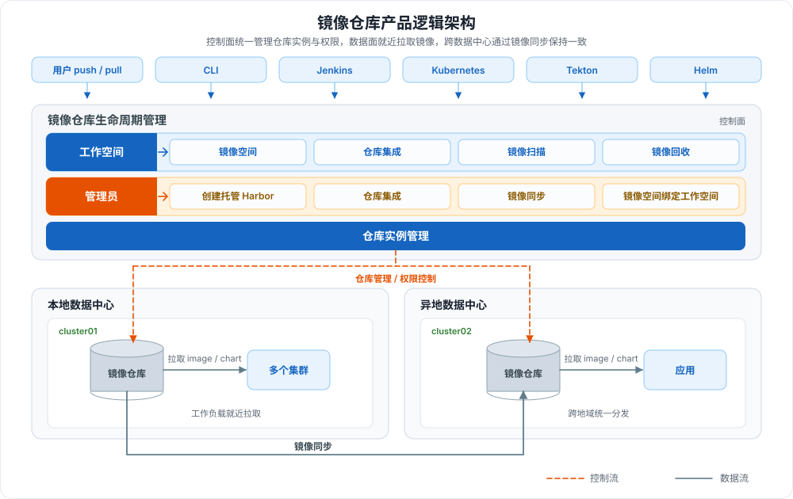

---
hide:
  - toc
---

# 什么是镜像仓库

镜像仓库（Kangaroo）是面向云原生环境的镜像托管服务，支持将仓库实例部署到任意云原生基础环境，并集成已有的 Harbor Registry、Docker Registry 和 JFrog Registry。
通过私有镜像空间与工作空间（租户）的绑定，既可以为单个或多个工作空间隔离分配镜像资产，也可以将镜像空间开放给集群内所有 Kubernetes 命名空间使用；配合[容器管理](../../kpanda/intro/index.md)的「选择镜像」能力，可快速完成应用部署。

## 产品逻辑架构

架构分为控制面与数据面：

| 层面 | 角色/组件 | 职责 | 图中标识 |
| --- | --- | --- | --- |
| **控制面** | 工作空间 | 使用镜像空间、仓库集成、镜像扫描与镜像回收 | 蓝色分组 |
| **控制面** | 管理员 | 创建托管 Harbor、集成仓库、配置镜像同步，以及将镜像空间绑定至工作空间 | 橙色分组 |
| **控制面** | 仓库实例管理 | 统一纳管各数据中心的仓库实例，向本地与异地集群下发仓库管理与权限控制策略 | 橙色虚线 |
| **数据面** | 集群 | 从所属数据中心的镜像仓库拉取 `image / chart` 并部署应用 | 灰色实线 |
| **数据面** | 镜像同步 | 两地仓库之间保持制品一致 | 灰色实线 |

## 核心能力

镜像仓库是多产品线共用的镜像托管模块，覆盖仓库实例、镜像资产与应用交付的完整链路：

-   :material-cog-outline:{ .lg .middle } __仓库全生命周期管理__

    ---

    通过托管 Harbor 提供镜像仓库的全生命周期管理，包括仓库实例的创建、编辑、删除等，支持多实例统一纳管。

    [:arrow_forward: 托管 Harbor](../managed/intro.md)

-   :material-transit-connection-variant:{ .lg .middle } __多维度集成外部仓库__

    ---

    支持管理员集成外部仓库后，将镜像空间分配给一个或多个工作空间（租户）使用；也支持工作空间独立集成外部镜像仓库。

    [:arrow_forward: 仓库集成（管理员）](../integrate/integrate-admin/integrate-admin.md)

-   :material-security:{ .lg .middle } __镜像扫描__

    ---

    支持镜像扫描功能，识别镜像中的安全风险；离线环境同样可以开启镜像安全扫描。

    [:arrow_forward: 镜像扫描](../space/scan.md)

-   :material-send-outline:{ .lg .middle } __便捷式应用部署__

    ---

    与容器管理模块联动，通过「选择镜像」功能快速选择镜像，完成应用部署。

    [:arrow_forward: 了解容器管理](../../kpanda/intro/index.md)

-   :material-autorenew:{ .lg .middle } __镜像同步__

    ---

    支持手动 / 定时两种同步方式，可将镜像同步至目标仓库，或将目标仓库镜像同步至本仓库。

    [:arrow_forward: 配置镜像同步](../integrate/integrate-admin/sync.md)

-   :material-cube-outline:{ .lg .middle } __镜像回收__

    ---

    支持设置镜像回收规则，通过定时 / 手动方式将符合条件的镜像移入回收站，控制仓库容量。

    [:arrow_forward: 镜像回收](../space/reclaim.md)

## 下一步

按角色或任务选择接下来要阅读的文档：

-   :material-run-fast:{ .lg .middle } __快速入门__

    ---

    - [管理外部镜像仓库](../quickstart/registry-in-one.md)
    - [推送镜像](../quickstart/push.md)
    - [Admin 上手指南](../quickstart/admin-registry.md)

-   :material-connection:{ .lg .middle } __仓库集成与镜像空间__

    ---

    - [仓库集成（管理员）](../integrate/integrate-admin/integrate-admin.md)
    - [仓库集成（工作空间）](../integrate/integrate-ws.md)
    - [镜像空间](../space/index.md)

-   :material-database-outline:{ .lg .middle } __托管 Harbor__

    ---

    - [托管 Harbor 概述](../managed/intro.md)
    - [创建托管 Harbor 实例](../managed/harbor.md)
    - [容量资源规划](../best-practice/capacity-planning.md)

[下载中心](https://docs.daocloud.io/download/){ .md-button }
[了解 Token 工厂效能平台](https://docs.daocloud.io/tf/){ .md-button }
[了解 d.run AI 操作系统](https://docs.daocloud.io/drun/){ .md-button }
[查看《镜像仓库用户手册》PDF](https://harbor-test2.cn-sh2.ufileos.com/docs/download/docs/kangaroo.pdf){ .md-button }
