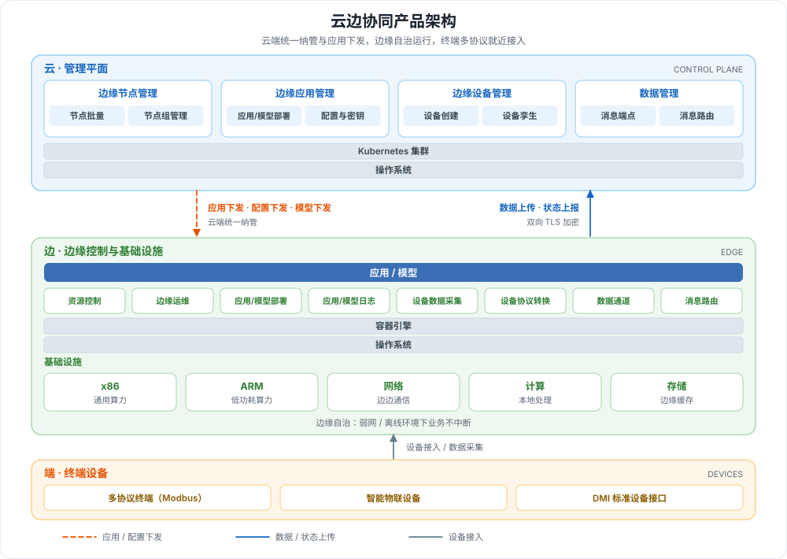

---
hide:
  - toc
---

# 什么是云边协同

物联网接入节点呈爆发式增长，集中式云计算已难以满足海量数据的实时传输与处理需求；云边协同（Kant）将云原生能力延伸至边缘，采用「端-边-云」一体化协同架构，把数据处理、业务应用与 AI 模型下沉到边缘执行。云端统一管理边缘节点、应用与设备，边缘侧在弱网 / 离线环境下仍可自治运行，设备侧支持多协议终端接入，从而解决响应实时性、数据隐私性与维护便利性问题，广泛适用于工业互联网、智慧工厂、智慧园区、智慧零售等场景。

## 产品架构

架构自上而下分为云、边、端三层：

| 层面 | 组件 | 职责 | 图中标识 |
| --- | --- | --- | --- |
| **云** | 管理平面 | 统一纳管边缘节点、下发应用与模型、管理设备孪生、配置消息端点与路由 | 蓝色区域 |
| **云** | Kubernetes 集群 / 操作系统 | 承载云端控制面，向边缘下发应用、配置与模型，接收数据与状态上报 | 蓝色横条、橙色虚线 |
| **边** | 应用 / 模型、边缘控制 | 运行容器化应用与模型，提供资源控制、边缘运维、设备数据采集与协议转换、数据通道 | 绿色区域 |
| **边** | 容器引擎、操作系统、基础设施 | 基于 x86、ARM 与网络、计算、存储资源，在弱网或离线时保持业务连续 | 绿色底座 |
| **端** | 多协议终端与智能物联设备 | 通过 Modbus 等协议及 DMI 标准接口接入边缘节点，就近采集并上报数据 | 橙色区域、灰色箭头 |

## 核心能力

云边协同围绕边缘节点、应用模型、终端设备与数据协同提供完整能力：

-   :material-server-network:{ .lg .middle } __边缘节点管理__

    ---

    支持海量边缘节点接入，提供 Token 与证书两种纳管方式，可在云端统一管理、监控和运维节点及节点组。

    [:arrow_forward: 边缘节点概述](../user-guide/node/index.md)

-   :material-cube-outline:{ .lg .middle } __边缘应用与模型__

    ---

    将应用或模型打包为容器镜像，快速部署到边缘节点运行，支持查看运行数据、事件与日志，以及 CPU / GPU 调度。

    [:arrow_forward: 边缘应用概述](../user-guide/edge-app/index.md)

-   :material-developer-board:{ .lg .middle } __终端设备接入__

    ---

    支持 Modbus 等多种协议终端接入，通过 DMI 标准接口对接设备能力，接入后可在云端统一管理设备与设备孪生。

    [:arrow_forward: 终端设备概述](../user-guide/device/index.md)

-   :material-transit-connection-variant:{ .lg .middle } __边云消息路由__

    ---

    配置消息路由规则，将边缘消息按路径转发至 rest、eventbus、servicebus 等端点；支持图片、视频等非结构化数据云边双向传输。

    [:arrow_forward: 边云消息概述](../user-guide/route/index.md)

-   :material-lan:{ .lg .middle } __应用网格__

    ---

    通过服务发现与流量代理实现边缘业务流量闭环，解决边缘场景下边缘业务之间的通信问题。

    [:arrow_forward: 应用网格概述](../user-guide/edge-network/index.md)

-   :material-shield-check-outline:{ .lg .middle } __边缘自治与安全__

    ---

    弱网 / 无网环境下边缘节点仍具备自我管理能力；提供平台、文件夹、工作空间多级权限、云边双向 TLS 加密与审计日志。

    [:arrow_forward: 产品优势](benefits.md)

## 学习路径

按下面的顺序依次完成，即可从创建边缘单元到打通云边数据通道：

  <a class="kant-path-step" style="--path-c:#2196f3" href="../user-guide/edge-unit/create-internal-unit/">
    1
    创建边缘单元
    创建专有边缘单元，为边缘业务准备运行环境
    前往 →
  </a>
  <a class="kant-path-step" style="--path-c:#00acc1" href="../user-guide/node/access-guide/">
    2
    接入边缘节点
    用 Token 或证书把边缘节点纳管到云端
    前往 →
  </a>
  <a class="kant-path-step" style="--path-c:#43a047" href="../user-guide/edge-app/create-app/">
    3
    创建工作负载
    将应用或模型部署到边缘节点运行
    前往 →
  </a>
  <a class="kant-path-step" style="--path-c:#fb8c00" href="../user-guide/device/create-device-model/">
    4
    接入终端与数据
    创建设备模型与设备实例，再配置云边消息路由
    前往 →
  </a>

[下载中心](https://docs.daocloud.io/download/){ .md-button }
[了解 Token 工厂效能平台](https://docs.daocloud.io/tf/){ .md-button }
[了解 d.run AI 操作系统](https://docs.daocloud.io/drun/){ .md-button }
[查阅《云边协同用户手册》PDF](https://harbor-test2.cn-sh2.ufileos.com/docs/download/docs/kant.pdf){ .md-button }
