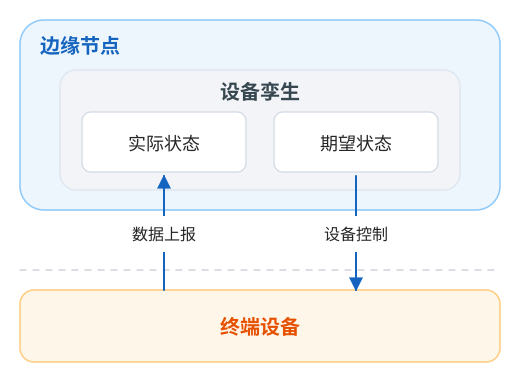

---
hide:
  - toc
---

# 终端设备概述

终端设备是云边协同「端 - 边 - 云」架构中最靠近物理世界的一层，可以小到传感器、控制器，大到智能摄像机或工控机床。终端设备通过 Modbus 等协议接入边缘节点，接入后即可在云端统一管理。平台用**设备模型**描述设备能提供的信息，用**设备孪生**记录设备的实时状态，二者共同构成云端对终端设备的数字化视图。

## 核心概念

| 概念 | 说明 |
| --- | --- |
| **终端设备** | 连接到边缘节点的物理设备，支持通过 Modbus 等协议接入；接入后可在云端统一管理，并可编辑基本信息、孪生属性、标签与访问配置。参见[创建终端设备](./create-device.md)。 |
| **设备模型** | 终端设备在云端的数字化表示，将同类设备的共同特征抽象为数据模型，用属性定义设备是什么、可以对外提供哪些信息。参见[创建设备模型](./create-device-model.md)。 |
| **设备孪生** | 终端设备的动态数据（孪生属性），同时记录应用设置的 **期望值** 与设备上报的 **实际值** ，例如灯的开、关状态。参见[管理终端设备](./manage-device.md)。 |

## 设备孪生工作机制

设备孪生具有与物理设备相同的特性，是终端设备与应用之间的中介：应用发送的命令首先到达设备孪生并更新期望状态，设备实时反馈自身的实际状态，设备孪生同时记录这两个值。

| 动作 | 方向 | 作用 |
| --- | --- | --- |
| **数据上报** | 终端设备 → 边缘节点（实际状态） | 设备把实时状态写入设备孪生的实际值，供边缘节点上的应用读取。 |
| **设备控制** | 边缘节点（期望状态） → 终端设备 | 应用修改设备孪生的期望值，由边缘节点下发到设备，以改变设备状态。 |
| **状态同步** | 设备离线 → 重新上线 | 设备再次上线时，以设备孪生中保存的状态完成同步，无需重新配置。 |

在云边协同模块中创建终端设备并与边缘节点关联后，边缘节点会保存被关联设备的孪生属性信息：边缘节点上的应用可以读取属性的实际值，也可以修改期望值来改变设备状态。

## 使用流程

管理和控制终端设备，通常按以下顺序执行：

-   :one: __[创建设备模型](./create-device-model.md)__

    ---

    抽象同类设备的共同特征，用属性定义设备可对外提供的数据。

-   :two: __[创建终端设备](./create-device.md)__

    ---

    在边缘单元中创建设备实例，填写基本信息与访问配置。

-   :three: __关联边缘节点__

    ---

    将设备绑定到边缘节点；绑定后边缘节点保存该设备的孪生属性，设备开始上报状态并接收下发指令。

-   :four: __[管理与监控](./manage-device.md)__

    ---

    编辑基本信息、孪生属性、标签与访问配置，并监测终端设备的运行状态。

[下载中心](https://docs.daocloud.io/download/){ .md-button }
[了解 Token 工厂效能平台](https://docs.daocloud.io/tf/){ .md-button }
[了解 d.run AI 操作系统](https://docs.daocloud.io/drun/){ .md-button }
