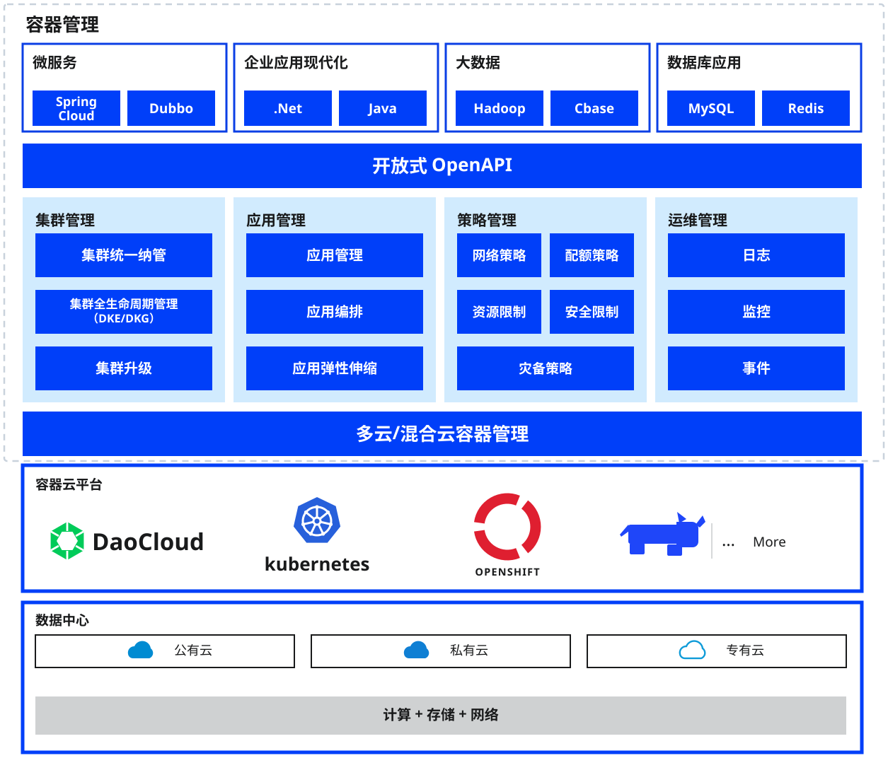
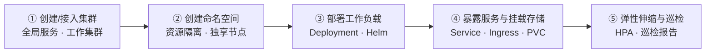

---
hide:
  - toc
---

# 容器管理

容器管理是基于 Kubernetes 构建的面向云原生应用的容器化管理模块。
基于原生多集群架构，解耦底层基础设施，实现多云与多集群统一化管理，大幅简化企业的应用上云流程，
有效降低运维管理和人力成本。通过容器管理，您可以便捷创建 Kubernetes 集群，快速搭建企业级的容器云管理平台。

## 核心能力

- :material-server:{ .lg .middle } __集群管理__

    ---

    支持全局服务集群、管理集群、工作集群、接入集群四种类型，覆盖集群的创建、接入、升级、角色与状态管理及运行时选择。

    [:arrow_forward: 创建集群](../user-guide/clusters/create-cluster.md)

- :fontawesome-brands-node:{ .lg .middle } __节点与命名空间__

    ---

    节点调度、标签与注解、污点管理、扩缩容与可用性检查；命名空间隔离、独享节点与 Pod 安全策略。

    [:arrow_forward: 节点调度](../user-guide/nodes/schedule.md)

- :octicons-tasklist-16:{ .lg .middle } __工作负载与弹性伸缩__

    ---

    创建 Deployment、StatefulSet、DaemonSet、Job/CronJob 等工作负载，并通过 HPA、VPA 策略实现弹性伸缩。

    [:arrow_forward: 创建 Deployment](../user-guide/workloads/create-deployment.md)

- :simple-helm:{ .lg .middle } __Helm 应用__

    ---

    提供数百个 Helm 模板，支持模板部署、应用管理与仓库管理，快速上线业务应用。

    [:arrow_forward: 浏览 Helm 模板](../user-guide/helm/README.md)

- :material-dot-net:{ .lg .middle } __网络与存储__

    ---

    通过 Service、Ingress、NetworkPolicy 管理流量与路由；奉行 Kubernetes 容器化存储理念，支持原生 CSI 与动态卷、卷快照、克隆。

    [:arrow_forward: 服务 Service](../user-guide/network/create-services.md)

- :material-security:{ .lg .middle } __安全与巡检__

    ---

    支持对节点、集群执行合规性扫描、权限扫描、漏洞扫描三类检查；集群巡检可自动或手动检查集群整体健康状态。

    [:arrow_forward: 创建巡检](../user-guide/inspect/config.md)

## 使用流程

使用容器管理通常分为 **平台准备** 与 **应用运行** 两个阶段：管理员先创建或接入集群并规划命名空间，业务用户随后部署工作负载、暴露服务，并通过弹性伸缩与巡检保障应用长期稳定运行。

| 步骤 | 角色 | 说明 |
| --- | --- | --- |
| ① [创建/接入集群](../user-guide/clusters/create-cluster.md) | 平台管理员 | 创建全局服务、管理、工作集群，或接入已有 Kubernetes 集群 |
| ② [创建命名空间](../user-guide/namespaces/createns.md) | 平台管理员 | 划分资源隔离边界，可配置命名空间独享节点与 Pod 安全策略 |
| ③ [部署工作负载](../user-guide/workloads/create-deployment.md) | 业务用户 | 通过镜像或 Helm 模板部署 Deployment、StatefulSet 等工作负载 |
| ④ [暴露服务](../user-guide/network/create-services.md)与[挂载存储](../user-guide/storage/pvc.md) | 业务用户 | 创建 Service / Ingress 暴露服务，通过 PVC 挂载持久化存储 |
| ⑤ [弹性伸缩与巡检](../user-guide/scale/create-hpa.md) | 平台管理员 | 配置 HPA/VPA 应对负载波动，定期巡检掌握集群健康状态 |

## 快速上手

  <a class="kpanda-path-step" style="--path-c:#2196f3" href="../user-guide/clusters/create-cluster/">
    1
    创建集群
    创建或接入 Kubernetes 集群
    Go →
  </a>
  <a class="kpanda-path-step" style="--path-c:#00acc1" href="../user-guide/namespaces/createns/">
    2
    创建命名空间
    资源隔离 · 独享节点
    Go →
  </a>
  <a class="kpanda-path-step" style="--path-c:#43a047" href="../user-guide/workloads/create-deployment/">
    3
    部署工作负载
    Deployment · Helm 模板
    Go →
  </a>
  <a class="kpanda-path-step" style="--path-c:#fb8c00" href="../user-guide/network/create-services/">
    4
    暴露服务
    Service · Ingress · PVC
    Go →
  </a>
  <a class="kpanda-path-step" style="--path-c:#8e24aa" href="../user-guide/scale/create-hpa/">
    5
    弹性伸缩
    HPA · VPA 策略
    Go →
  </a>

## 更多资源

- :material-format-list-bulleted:{ .lg .middle } __功能特性__

    ---

    一览容器管理在集群、节点、工作负载、网络存储与安全巡检上的完整功能清单。

    [:arrow_forward: 查看功能特性](features.md)

- :material-map-outline:{ .lg .middle } __应用场景__

    ---

    了解容器管理在多集群管理、应用发布、混合云等场景下的最佳实践。

    [:arrow_forward: 查看应用场景](scenarios.md)

- :material-chat-question-outline:{ .lg .middle } __常见问题__

    ---

    集群创建、工作负载运行与网络存储相关的常见问题与解决办法。

    [:arrow_forward: 查看常见问题](faq.md)

[下载中心](https://docs.daocloud.io/download/){ .md-button .md-button--primary }
[了解 Token 工厂效能平台](https://docs.daocloud.io/tf/){ .md-button .md-button--primary }
[了解 d.run AI 操作系统](https://docs.daocloud.io/drun/){ .md-button .md-button--primary }
[查阅《容器管理用户手册》PDF](https://harbor-test2.cn-sh2.ufileos.com/docs/download/docs/kpanda.pdf){ .md-button .md-button--primary }
