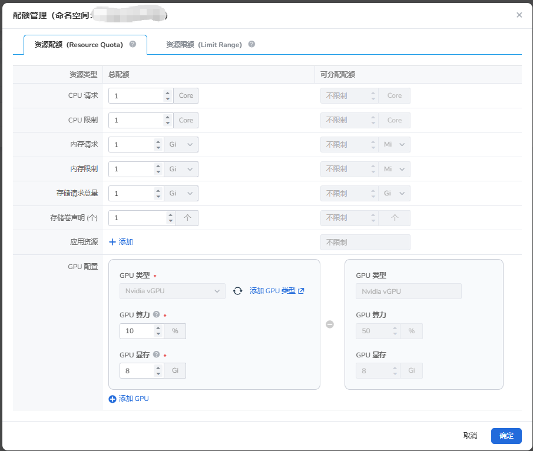

# GPU 配额管理

本节介绍如何在 DCE 平台使用 vGPU 能力。

## 前提条件

当前集群已通过 Operator 或手动方式部署对应类型 GPU 驱动（NVIDIA GPU、NVIDIA MIG、天数智芯、华为昇腾）

## 操作步骤

1. 进入 Namespaces 中，点击 **配额管理** 可以配置当前 Namespace 可以使用的 GPU 资源。

    

2. 当前命名空间配额管理覆盖的卡类型为：NVIDIA vGPU、NVIDIA MIG、天数智芯、华为昇腾。

3. **NVIDIA vGPU 配额管理**：配置具体可以使用的配额。保存后，系统会创建或更新 `ResourceQuota` CR：

    - **GPU 算力**（`nvidia.com/gpucores`）：当前命名空间可分配的 GPU 总算力，是多张 GPU 算力之和，因此可以超过 100%。
    - **GPU 显存**（`nvidia.com/gpumem`）：当前命名空间可分配的 GPU 总显存，是多张 GPU 显存之和。

    

    !!! note

        新版配额模型不再单独设置物理卡数量。

4. 命名空间的 GPU 配额从工作空间的共享资源总配额中分配：

    - **已分配额度** 是工作空间已分配给各命名空间的配额之和，并非 GPU 的实时使用量。
    - **剩余可用量 = 总配额 - 已分配额度**。
    - 工作空间下所有命名空间的配额总和不能超过共享资源总配额，否则无法将该命名空间绑定到工作空间。
