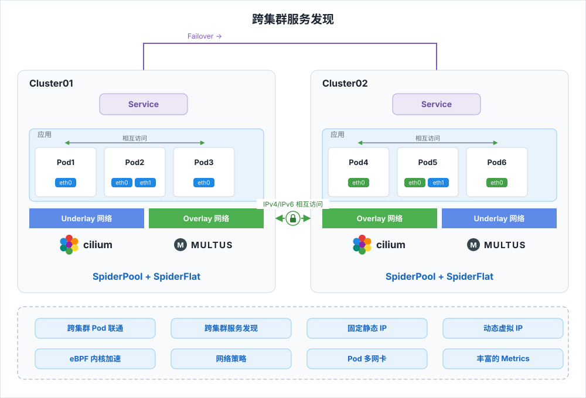
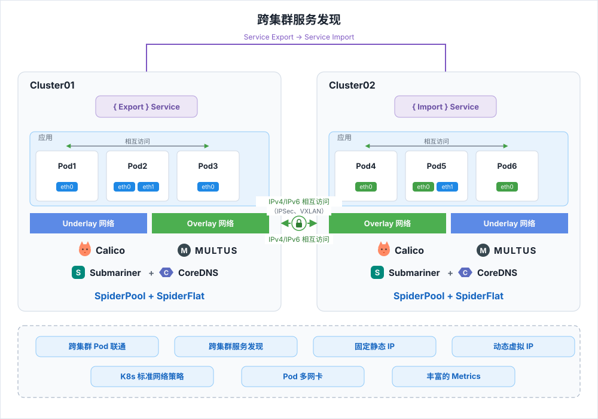

---
hide:
  - toc
---

# 什么是云原生网络？

云原生网络基于多个开源技术构建，不仅提供单个 CNI 网络支持，也提供多个 CNI 网络的组合方案。

-   :material-lan:{ .lg .middle } __Cilium 组合__

    ---

    适用于高内核版本（4.19.57+），以 eBPF 加速的 Overlay 网络搭配 Underlay 网络，实现跨云跨集群连通。

    [:arrow_forward: 查看方案](#cilium-macvlansr-iovipvlan-spiderpool-multus)

-   :material-server-network:{ .lg .middle } __Calico 组合__

    ---

    适用于低内核版本，基于 iptables 的 Overlay 网络搭配 Underlay 网络，通过 Submariner 打通跨集群。

    [:arrow_forward: 查看方案](#calico-macvlansr-iovipvlan-spiderpool-multus)

-   :material-chip:{ .lg .middle } __AI/RDMA 快速入口__

    ---

    构建 AI 集群或高性能计算集群？从 RDMA 网络方案开始。

    [:arrow_forward: 前往阅读](#airdma)

## Cilium + Macvlan/SR-IOV/IPvlan + SpiderPool + Multus

适用于 Linux 高内核版本（4.19.57+）的场景。
方案以 Multus 为调度核心组合多个 CNI：Cilium 提供 eBPF 加速的 Overlay 网络，Macvlan / SR-IOV / IPvlan 提供 Underlay 网络，SpiderPool 统一管理 Underlay 网络的 IP 分配与回收，从而在跨云跨集群场景下实现网络连通，并以不同 IP 池满足不同应用的通信需求。

下图展示了该方案的架构：

各组件的角色与适用条件如下：

| 组件 | 角色 | 是否必备 | 说明 |
| --- | --- | --- | --- |
| Multus | 调度核心 | 可选 | 为 Pod 分配多个 CNI 的 IP，支持应用的多态网络通信与集群内跨 CNI 的 Pod 间通信；应用没有 Pod 多网卡或多种网络形态需求时可不安装 |
| SpiderPool | Underlay IPAM | 可选 | 精细化管理 IP，提供灵活的 IP 规划与分配；应用场景中未使用 Underlay CNI 时可不安装 |
| Cilium | Overlay CNI | 必备 | 以 eBPF 提供内核加速，实现高性能 Overlay 网络、跨集群 Pod 与 Service 通信，并支持细粒度网络策略下发和丰富的流量观测 |
| Macvlan / SR-IOV / IPvlan | Underlay CNI | 可选 | 为 Pod 提供对外访问 IP，实现二层对外通信；搭配 Cilium 动态虚拟网络可降低网络运维难度并节省 IP 资源；没有对外访问需求时可不安装 |

## Calico + Macvlan/SR-IOV/IPvlan + SpiderPool + Multus

适用于 Linux 低内核版本的场景，适合有跨集群连通、多 CNI 等需求的环境。
方案同样以 Multus 为调度核心组合多个 CNI：Calico 提供基于 iptables 的 Overlay 网络，Macvlan / SR-IOV / IPvlan 提供 Underlay 网络，SpiderPool 管理 Underlay 网络的 IP，Submariner 与 CoreDNS 负责跨集群通信与服务发现。

下图展示了该方案的架构：

各组件的角色与适用条件如下：

| 组件 | 角色 | 是否必备 | 说明 |
| --- | --- | --- | --- |
| Multus | 调度核心 | 可选 | 为 Pod 分配多个 CNI 的 IP，支持应用的多态网络通信与集群内跨 CNI 的 Pod 间通信；应用没有 Pod 多网卡或多种网络形态需求时可不安装 |
| SpiderPool | Underlay IPAM | 可选 | 精细化管理 IP，提供灵活的 IP 规划与分配；应用场景中未使用 Underlay CNI 时可不安装 |
| Calico | Overlay CNI | 必备 | 提供基于 iptables 的 Overlay 网络，支持 K8s 标准网络策略 |
| Macvlan / SR-IOV / IPvlan | Underlay CNI | 可选 | 为 Pod 提供对外访问 IP，实现二层对外通信；搭配 Calico 动态虚拟网络可降低网络运维难度并节省 IP 资源；没有对外访问需求时可不安装 |
| Submariner + CoreDNS | 跨集群通信 | 可选 | Submariner 打通跨集群 Pod 间的通信，CoreDNS 提供跨集群的服务发现能力；可按需选择安装 |

## AI/RDMA 快速入口

如果您在构建 AI 集群或高性能计算集群，请先阅读 [AI/RDMA 网络方案总览](../modules/spiderpool/install/ai-rdma.md)，了解各方案的对比与选型建议，再按场景选择部署方式：

-   :material-share-variant:{ .lg .middle } __共享 RDMA（Macvlan/IPvlan）__

    ---

    多个 Pod 共享 RDMA 设备（RoCE 协议），资源利用率高，适用于成本敏感、快速落地的通用场景。

    [:arrow_forward: 开始阅读](../modules/spiderpool/install/rdma-macvlan.md)

-   :material-connection:{ .lg .middle } __独享 RDMA（SR-IOV RoCE）__

    ---

    通过 SR-IOV 独享 RoCE 网卡，性能与隔离最优，适用于高性能训练/推理场景。

    [:arrow_forward: 开始阅读](../modules/spiderpool/install/rdma-sriov-roce.md)

-   :material-developer-board:{ .lg .middle } __独享 RDMA（SR-IOV InfiniBand）__

    ---

    通过 SR-IOV 独享 InfiniBand 网卡，适用于 InfiniBand Fabric 环境。

    [:arrow_forward: 开始阅读](../modules/spiderpool/install/rdma-sriov-ib.md)

[下载中心](https://docs.daocloud.io/download/){ .md-button .md-button--primary }
[了解 Token 工厂效能平台](https://docs.daocloud.io/tf/){ .md-button .md-button--primary }
[了解 d.run AI 操作系统](https://docs.daocloud.io/drun/){ .md-button .md-button--primary }
[查看《网络用户手册》PDF](https://harbor-test2.cn-sh2.ufileos.com/docs/download/docs/network.pdf){ .md-button }
