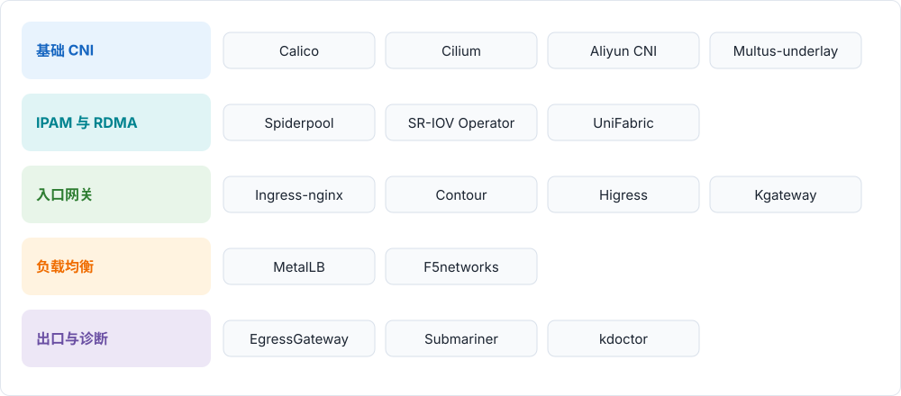

---
hide:
  - toc
---

# 网络组件

云原生网络方案将主流开源网络组件按能力组合，能够满足各种复杂场景的需求。本页按 `network/modules/` 的目录结构，将全部 16 个组件分为 5 类；每个组件均可按需独立安装，也可与其他组件组合使用。

## 组件清单

### 基础 CNI {: #basic-cni }

| 组件 | 说明 |
| --- | --- |
| [Calico](calico/index.md) | 基于 Linux kernel 技术实现的 Virtual Router，完成数据平面的转发。 |
| [Cilium](cilium/index.md) | 基于 eBPF 内核构建的网络方案 |
| [Aliyun CNI](aliyun-terway/index.md) | 运行在阿里云上的 CNI 插件，提供稳定、高性能，支持Kubernetes network policy、流控等高级特性。 |
| [Multus-underlay](multus-underlay/index.md) | 基于 Multus、搭配 Macvlan + SR-IOV CNI 的多网卡方案。 |

### IPAM 与 RDMA {: #ipam-rdma }

| 组件 | 说明 |
| --- | --- |
| [Spiderpool](spiderpool/index.md) | 自动化管理 IP 资源 |
| [SR-IOV Network Operator](sriov-network-operator/index.md) | 整合 sriov-cni 与 sriov-device-plugin，通过 CRD 统一配置 SR-IOV 网卡，降低使用难度。 |
| [UniFabric](unifabric/index.md) | 自动发现 RDMA 网络拓扑并发布为 Kubernetes 自定义资源，为节点添加拓扑标签，提供节点级 RDMA 指标。 |

### 入口网关 {: #ingress-gateway }

| 组件 | 说明 |
| --- | --- |
| [Ingress-nginx](ingress-nginx/index.md) | Kubernetes 社区托管的 Ingress 控制器，使用 nginx 作为反向代理和负载均衡。 |
| [Contour](contour/index.md) | 一个开源的 Kubernetes Ingress 控制器，使用 Envoy 作为数据面。 |
| [Higress](higress/index.md) | Higress 是一款云原生 API 网关，内核基于 Istio 和 Envoy，可以用 Go/Rust/JS 等编写 Wasm 插件，提供了数十个现成的通用插件，以及开箱即用的控制台。并且提供 Kubernetes Ingress 网关、 AI 网关、微服务网关等能力。 |
| [Kgateway](kgateway/index.md) | kgateway 是一个基于 Envoy 代理并深度集成 Kubernetes Gateway API 的高性能、云原生 API 网关，旨在为 AI 推理、微服务治理及跨集群流量调度提供下一代控制面。 |

### 负载均衡 {: #load-balancing }

| 组件 | 说明 |
| --- | --- |
| [MetalLB](metallb/index.md) | 裸金属版的 Kubernetes 负载均衡器方案。 |
| [f5networks](f5networks/index.md) | 全面控制 F5 设备，将集群中 service 和 ingress 配置同步到 F5 硬件设备上，实现集群北向入口的负载均衡。 |

### 出口与诊断 {: #egress-diagnostics }

| 组件 | 说明 |
| --- | --- |
| [EgressGateway](egressgateway/index.md) | 开源的 Egress 网关，为租户级或集群级工作负载设置固定 Egress IP，解决不同 CNI 模式下 Pod 出口 IP 不固定的问题。 |
| [Submariner](submariner/index.md) | 跨集群的网络通讯方案 |
| [kdoctor](kdoctor/index.md) | 基于主动式压力注入的 Kubernetes 数据面测试组件，对集群进行功能与性能巡检。 |

!!! note

    以上所有 CNI 和 Ingress 等组件可以按需安装。安装方式、版本要求与组合建议，请参见各组件的文档。

[下载中心](https://docs.daocloud.io/download/){ .md-button }
[了解 Token 工厂效能平台](https://docs.daocloud.io/tf/){ .md-button }
[了解 d.run AI 操作系统](https://docs.daocloud.io/drun/){ .md-button }
