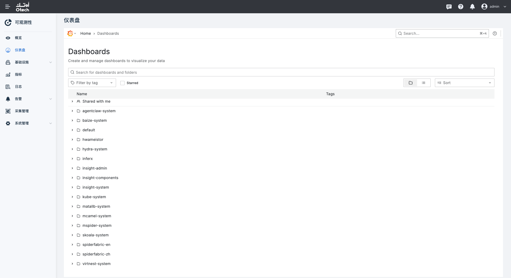

# 在全局集群安装 Spiderfabric

Spiderfabric 需要安装在全局集群中，为集群拓扑发现提供 Grafana 数据源后端。安装过程中还会下发 `GrafanaDashboard` 资源。以下步骤通过 DCE 的 Helm 模板完成安装。

## 前提条件

- 全局集群已接入 DCE，且当前账号具有安装 Helm 应用的权限。
- Helm 模板仓库中已提供 Spiderfabric 模板。
- 已为 Spiderfabric 准备可用的存储类。Spiderfabric 的持久化配置要求填写 `storageClass`。

## 安装步骤

1. 在集群列表中进入全局集群。实际集群名称以当前环境为准。

    

2. 在左侧导航栏选择 **Helm 应用 > Helm 模板**，搜索并选择 `spiderfabric`。

    

3. 配置应用基本信息。应用名称和命名空间可使用默认值，也可以按环境规范调整。选择仓库中可用的模板版本。截图中的 `1.0.1` 仅为示例版本。

4. 配置模板参数。

    - 在 **Persistence** 中填写已准备好的 `storageClass`，并按数据保留需求设置存储容量。该字段不能为空。
    - 只有后续需要使用 eBPF Flow 时才开启 Elasticsearch，否则保持关闭。开启后，使用外部 Elasticsearch 时填写集群可访问的端点和认证信息。请勿直接使用截图中的示例凭据。
    - 检查镜像仓库、资源请求与限制等参数是否符合当前环境。

    

    

5. 单击 **下一步**，检查 Kubernetes 编排内容，确认配置无误后提交安装。

    

## 验证安装

在全局集群的 **Helm 应用**列表中确认 Spiderfabric 应用已成功部署。若部署失败，检查 Helm 安装任务详情。在 Grafana 的 **Dashboards** 页面中，确认存在 `spiderfabric-zh` 或 `spiderfabric-en` 文件夹。