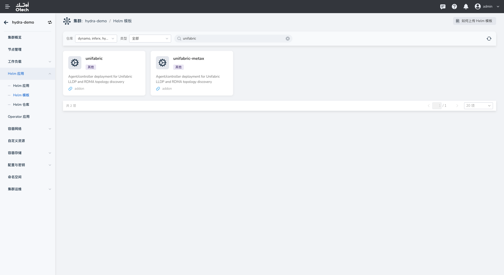
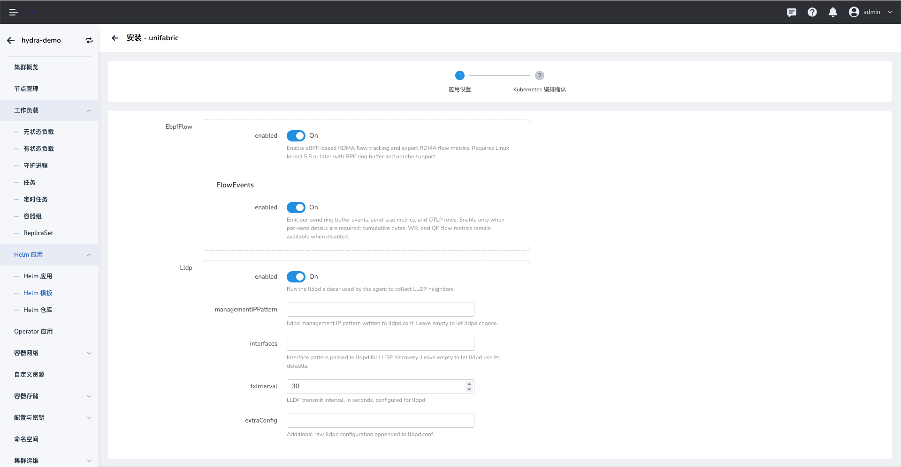

# 在工作集群安装 Unifabric

在全局集群安装 Spiderfabric 后，可在需要采集 RDMA 网络信息的工作集群中安装 Unifabric。以下步骤通过 DCE 的 Helm 模板完成安装。

## 前提条件

- 目标工作集群已接入 DCE，且当前账号具有安装 Helm 应用的权限。
- 已在全局集群安装 Spiderfabric。
- 工作集群中需要采集 RDMA 信息的节点具备 RDMA 网络能力。

## 安装步骤

1. 在集群列表中进入需要安装 Unifabric 的工作集群。

    

2. 在左侧导航栏选择 **Helm 应用 > Helm 模板**，搜索并选择 `unifabric`。

    

3. 配置应用基本信息，并选择仓库中可用的模板版本。截图中的 `0.4.2` 仅为示例版本。

4. 按实际网络环境配置模板参数。

    - 在 **TopoDiscovery** 中分别设置 ScaleUp、ScaleOut 和 Storage 的发现模式。截图示例为 `manual`、`nv-topograph` 和 `unifabric-roce`。请根据集群使用的拓扑发现方案选择。
    - **EbpfFlow（可选）**：如需采集 RDMA Flow 指标，可启用该功能。启用后要求 Linux 内核版本为 5.8 或更高版本，并支持 BPF ring buffer 和 uprobe。
    - **FlowEvents** 用于发送逐流事件、发送大小指标和 OTLP 数据。仅在需要逐发送详情时启用。关闭后仍可获取累计字节数、WR 和 QP Flow 指标。
    - 按需配置 Elasticsearch。使用外部 Elasticsearch 时，填写工作集群可访问的端点和认证信息。也可按模板提供的方式使用现有 Secret。
    - 核对其他参数，尤其是镜像仓库、资源配置及各组件的启用状态。

    

    

5. 单击 **下一步**，在 Kubernetes 编排确认页检查生成的 YAML。确认目标集群、命名空间和参数正确后提交安装。

    

## 验证安装

在目标工作集群的 **Helm 应用**列表中确认 Unifabric 应用已成功部署。也可以在集群中检查安装表单所示命名空间内的 Pod 状态：

```bash
kubectl get pods -n <namespace>
```

将 `<namespace>` 替换为安装时选择的命名空间。确认 Unifabric Controller 和节点 Agent 均已就绪。