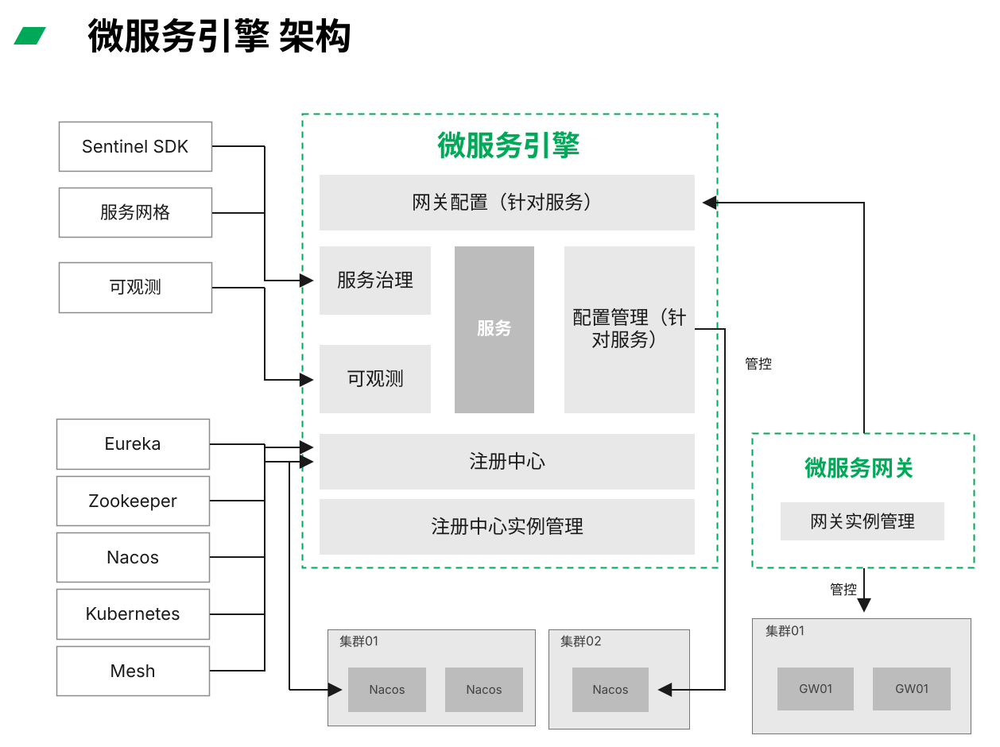

---
hide:
  - toc
---

# 微服务引擎

「DaoCloud 道客」微服务引擎是面向业界主流微服务生态的一站式微服务管理平台，主要提供微服务治理中心和微服务网关两个维度的功能，
具体包括服务注册发现、配置管理、流量治理、服务级别的链路追踪、API 管理、域名管理、监控告警等，覆盖了微服务生命周期中的各种管理场景。
微服务引擎具有很强的兼容性，不仅可以无缝对接 DaoCloud 的其他组件，也可以完美兼容 Spring Cloud、Dubbo 等开源生态，
帮助您更便捷地使用开源微服务技术构建自己的微服务体系。

## 产品全景

  

    
南北向流量 · 微服务网关

    

      <a class="tf-arch-card tf-arch-card--model" href="../gateway/">
        网关管理
        多集群网关实例全生命周期管理
      </a>
      <a class="tf-arch-card tf-arch-card--model" href="../gateway/api/">
        API 管理
        API 策略与安全认证
      </a>
      <a class="tf-arch-card tf-arch-card--model" href="../gateway/domain/">
        域名管理
        域名与策略配置
      </a>
      <a class="tf-arch-card tf-arch-card--model" href="../gateway/alert/">
        监控告警
        资源与业务双维监控
      </a>
    

  

  
▲

  

    
东西向流量 · 云原生微服务

    

      <a class="tf-arch-card tf-arch-card--compute" href="../cloud-ms/traffic-control/">
        服务治理
        Mesh 与 Istio 流量治理
      </a>
      <a class="tf-arch-card tf-arch-card--compute" href="../cloud-ms/lane/">
        流量泳道
        全链路灰度发布
      </a>
      <a class="tf-arch-card tf-arch-card--compute" href="../standard/monitor/">
        Sentinel 监控
        流控规则效果观测
      </a>
    

  

  
▲

  

    
东西向流量 · 传统微服务

    

      <a class="tf-arch-card tf-arch-card--compute" href="../trad-ms/hosted/">
        注册配置中心
        Nacos 托管与配置管理
      </a>
      <a class="tf-arch-card tf-arch-card--compute" href="../trad-ms/integrated/">
        接入注册中心
        Eureka / ZooKeeper / Nacos / Consul
      </a>
      <a class="tf-arch-card tf-arch-card--compute" href="../standard/sentinel/">
        接入 Sentinel
        流控、熔断降级、热点限流
      </a>
    

  

  
▲

  

    
公共支撑

    

      <a class="tf-arch-card tf-arch-card--ops" href="../plugins/intro/">
        插件中心
        Wasm 插件与一键启停
      </a>
      <a class="tf-arch-card tf-arch-card--ops" href="features/">
        功能特性
        完整功能清单
      </a>
      <a class="tf-arch-card tf-arch-card--ops" href="scenarios/">
        适用场景
        典型场景与产品优势
      </a>
    

  

## 产品架构

## 文档导航

-   :material-run-fast:{ .lg .middle } __快速入门__

    ---

    - [微服务引擎管理组件](../quickstart/skoala.md)
    - [微服务引擎集群初始化组件](../quickstart/skoala-init.md)
    - [选择工作空间](../quickstart/select-workspace.md)
    - [skoala-init 故障排查](../troubleshoot/auth-server.md)

-   :material-connection:{ .lg .middle } __服务对接规范__

    ---

    - [接入 Sentinel](../standard/sentinel.md)
    - [接入 Nacos SDK](../standard/nacos.md)
    - [接入 Sentinel 监控](../standard/monitor.md)
    - [接入 Sentinel 集群流控](../standard/flow-control.md)

-   :fontawesome-solid-cubes-stacked:{ .lg .middle } __最佳实践__

    ---

    - [示例应用体验微服务治理](../best-practice/use-skoala-01.md)
    - [在云原生微服务中使用 JWT 插件](../best-practice/plugins/jwt.md)
    - [微服务网关接入认证服务器](../best-practice/auth-server.md)
    - [网关 API 策略](../best-practice/gateway02.md)

-   :material-engine:{ .lg .middle } __云原生微服务__

    ---

    - [导入/移除服务](../cloud-ms/traffic-control.md)
    - [服务治理](../cloud-ms/traffic-control.md)
    - [Nacos 压力测试报告](../tests/nacos-stress-test.md)

-   :material-gate:{ .lg .middle } __云原生网关__

    ---

    - [网关管理](../gateway/index.md)
    - [API 管理](../gateway/api/index.md)
    - [服务接入](../gateway/service/manual-integrate.md)
    - [监控告警](../gateway/alert.md)
    - [域名管理](../gateway/domain/index.md)
    - [网关压力测试报告](../tests/gateway-stress-test.md)

-   :simple-legacygames:{ .lg .middle } __传统微服务__

    ---

    - [注册配置中心](../trad-ms/hosted/index.md)
        - [微服务列表](../trad-ms/hosted/services/index.md)
        - [微服务配置管理](../trad-ms/hosted/configs.md)
        - [微服务监控](../trad-ms/hosted/monitor/microservices.md)
    - [接入注册中心](../trad-ms/integrated/index.md)
        - [微服务管理](../trad-ms/integrated/manage-service.md)
        - [链路追踪](../trad-ms/integrated/trace.md)

## 学习路径

  <a class="skoala-path-step" style="--path-c:#2196f3" href="../quickstart/skoala/">
    1
    部署引擎组件
    安装微服务引擎管理组件
    前往 →
  </a>
  <a class="skoala-path-step" style="--path-c:#00acc1" href="../quickstart/skoala-init/">
    2
    初始化托管组件
    安装集群初始化组件 skoala-init
    前往 →
  </a>
  <a class="skoala-path-step" style="--path-c:#43a047" href="../quickstart/select-workspace/">
    3
    选择工作空间
    为微服务和网关划定管理边界
    前往 →
  </a>
  <a class="skoala-path-step" style="--path-c:#fb8c00" href="../trad-ms/integrated/">
    4
    接入微服务
    接入注册中心，纳管传统与云原生微服务
    前往 →
  </a>
  <a class="skoala-path-step" style="--path-c:#8e24aa" href="../cloud-ms/traffic-control/">
    5
    治理流量
    Sentinel / Mesh 治理东西向流量
    前往 →
  </a>
  <a class="skoala-path-step" style="--path-c:#e53935" href="../gateway/">
    6
    配置网关
    创建网关实例，管理南北向 API
    前往 →
  </a>

[下载中心](https://docs.daocloud.io/download/){ .md-button }
[了解 Token 工厂效能平台](https://docs.daocloud.io/tf/){ .md-button }
[了解 d.run AI 操作系统](https://docs.daocloud.io/drun/){ .md-button }
[查阅《微服务引擎用户手册》PDF](https://harbor-test2.cn-sh2.ufileos.com/docs/download/docs/skoala.pdf){ .md-button }
