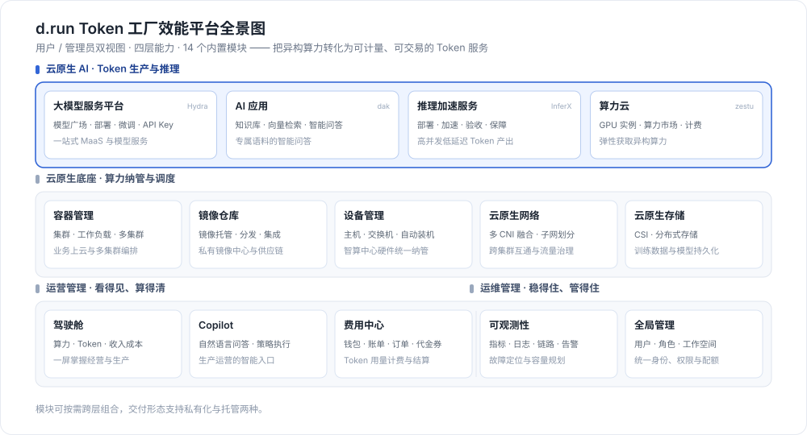

---
hide:
  - toc
---

# Token 工厂

Token 工厂是 DaoCloud 面向 AI 智算场景打造的一体化平台，围绕大模型推理、算力调度和集群运维提供端到端能力支撑。
平台采用 **用户** 与 **管理员** 双视图架构：用户视图面向终端用户，提供大模型服务调用、费用管理和智能应用接入能力；管理员视图面向运维管理团队，提供模型托管、推理引擎、基础设施和全局运营的统一管控。
[查看/下载 Token 工厂彩页](https://harbor-test2.cn-sh2.ufileos.com/docs/download/tf.pdf){ .md-button }

  

    
云原生 AI

    

      <a class="tf-arch-card tf-arch-card--model" href="hydra/">
        大模型服务平台
        模型部署与运维管理
      </a>
      <a class="tf-arch-card tf-arch-card--model" href="dak/">
        AI 应用
        智能问答等应用能力
      </a>
      <a class="tf-arch-card tf-arch-card--model" href="inferx/">
        推理加速服务
        推理加速与引擎管理
      </a>
      <a class="tf-arch-card tf-arch-card--model" href="zestu/">
        算力云
        异构算力纳管与调度
      </a>
    

  

  
▲

  

    
云原生底座

    

      <a class="tf-arch-card tf-arch-card--compute" href="kpanda/intro/">
        容器管理
        集群与工作负载管理
      </a>
      <a class="tf-arch-card tf-arch-card--compute" href="kangaroo/intro/">
        镜像仓库
        镜像托管与集成
      </a>
      <a class="tf-arch-card tf-arch-card--compute" href="topohub/intro/">
        设备管理
        硬件设备统一纳管
      </a>
      <a class="tf-arch-card tf-arch-card--compute" href="network/intro/">
        云原生网络
        多 CNI 融合网络
      </a>
      <a class="tf-arch-card tf-arch-card--compute" href="storage/">
        云原生存储
        容器化存储与 CSI
      </a>
    

  

  
▲

  

    
运营管理

    

      <a class="tf-arch-card tf-arch-card--ops" href="copilot/">
        Copilot
        智能运维助手
      </a>
      <a class="tf-arch-card tf-arch-card--ops" href="crane/intro/">
        驾驶舱
        运营数据可视化
      </a>
      <a class="tf-arch-card tf-arch-card--ops" href="leopard/">
        费用中心
        计费与账单分析
      </a>
    

  

  
▲

  

    
运维管理

    

      <a class="tf-arch-card tf-arch-card--ops" href="insight/intro/">
        可观测性
        指标日志链路观测
      </a>
      <a class="tf-arch-card tf-arch-card--ops" href="ghippo/intro/">
        全局管理
        用户权限与平台设置
      </a>
    

  

作为面向智算中心打造的高效能 AI Token 生产及经营系统，Token 工厂助力传统算力中心向高效、可盈利的 Token 生产运营模式升级。
平台统一纳管英伟达及国产异构算力，依靠智能调度与推理优化，把分散 GPU 算力转化为低成本、高稳定、可交易的标准化 Token 服务；
依托 Token 工厂管家与统一运营体系，完成资源、生产、成本、供需的全局管控，面向终端用户、管理员、运营者、运维者提供能力，
推动智算中心业务定位从 "提供算力" 升级为 "生产和运营 Token"。

## 学习路径

  <a class="tf-path-step" style="--path-c:#2196f3" href="install/">
    1
    部署平台
    离线安装 Token 工厂，完成初始化与授权
    前往 →
  </a>
  <a class="tf-path-step" style="--path-c:#00acc1" href="kpanda/intro/">
    2
    纳管算力
    接入 GPU 节点，创建工作集群
    前往 →
  </a>
  <a class="tf-path-step" style="--path-c:#43a047" href="hydra/">
    3
    部署模型
    模型广场选型，一键部署推理服务
    前往 →
  </a>
  <a class="tf-path-step" style="--path-c:#fb8c00" href="dak/">
    4
    构建应用
    搭建语料库与智能问答应用
    前往 →
  </a>
  <a class="tf-path-step" style="--path-c:#8e24aa" href="crane/intro/">
    5
    运营结算
    驾驶舱看运营，费用中心管计费
    前往 →
  </a>

[下载 Token 工厂离线包](https://docs.daocloud.io/download/tf/){ .md-button }
[安装 Token 工厂](install/index.md){ .md-button }
[查看/下载 Token 工厂彩页](https://harbor-test2.cn-sh2.ufileos.com/docs/download/tf.pdf){ .md-button }
{: .tf-footer-cta }
