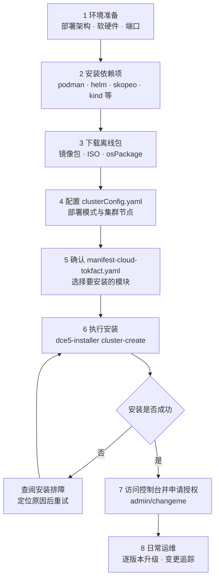

---
hide:
  - toc
---

# Token 工厂安装指南

本页是 d.run Token 工厂效能平台（以下简称 Token 工厂）的安装总入口，给出完整的安装链路、每个阶段对应的文档，
以及安装完成后的初始化顺序。

Token 工厂采用离线安装：在称为[火种节点](./commercial/deploy-arch.md)的机器上运行安装器 `dce5-installer`，
由它引导 Kubean 完成操作系统初始化与 Kubernetes 集群创建，再把 `manifest-cloud-tokfact.yaml` 中声明的产品模块部署到全局服务集群。
因此安装前需要备齐四类离线物料：离线镜像包、ISO 操作系统镜像、osPackage 离线包，以及可选的 Addon 离线包。

!!! tip "版本说明"

    本文以安装器 v0.45.0 为例。安装器、离线包与 osPackage 三者的版本必须相互匹配，各版本变化请查阅
    [安装器 Release Notes](./release-notes.md)。若要安装 d.run AI 操作系统，请参阅
    [d.run AI 操作系统安装指南](../../drun/install/index.md)，两者的清单文件与默认模块不同。

从环境准备到日常运维共八个阶段。安装失败时先定位原因，修正后从对应阶段重试。点击图中的阶段可直接跳转到对应文档。

安装完成并用 `admin/changeme` 登录后，建议按以下顺序完成初始化：

1. 在[全局管理](../ghippo/intro/index.md)中创建用户、用户组与工作空间，并规划角色权限。
2. 在[容器管理](../kpanda/intro/index.md)中创建工作集群，承接推理负载；建议使用 GPU 节点。
3. 进入[大模型服务平台](../hydra/index.md)部署或接入模型，配置 Token 与 API 调用。
4. 在[可观测性](../insight/intro/index.md)中确认指标与日志采集正常，在[驾驶舱](../crane/user-guide/singlepage.md)与[费用中心](../leopard/index.md)中核对运营数据与计量计费。

[下载中心](https://docs.daocloud.io/download/){ .md-button .md-button--primary }
[了解 Token 工厂效能平台](https://docs.daocloud.io/tf/){ .md-button .md-button--primary }
[了解 d.run AI 操作系统](https://docs.daocloud.io/drun/){ .md-button .md-button--primary }
