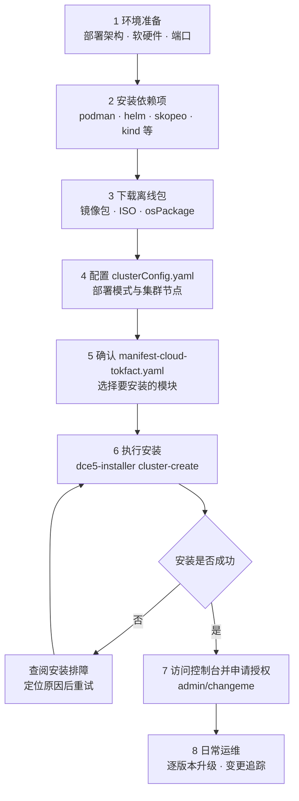

---
hide:
  - toc
---

# Token 工厂安装指南

本页是 d.run Token 工厂效能平台（以下简称 Token 工厂）的安装总入口，给出完整的安装链路、每个阶段对应的文档，
以及安装完成后的初始化顺序。

Token 工厂采用离线安装：在称为[火种节点](./commercial/deploy-arch.md)的机器上运行安装器 `dce5-installer`，
由它引导 Kubean 完成操作系统初始化与 Kubernetes 集群创建，再把 `manifest-cloud-tokfact.yaml` 中声明的产品模块部署到全局服务集群。
因此安装前需要备齐四类离线物料：离线镜像包、ISO 操作系统镜像、osPackage 离线包，以及可选的 Addon 离线包。

!!! tip "版本说明"

    以安装器 v0.46.0 为例，安装器、离线包与 osPackage 三者的版本必须相互匹配，各版本变化请查阅
    [安装器 Release Notes](./release-notes.md)。

## 安装流程

从环境准备到日常运维共八个阶段。安装失败时先定位原因，修正后从对应阶段重试。点击图中的阶段可直接跳转到对应文档。

## 下一步

安装完成并用 `admin/changeme` 登录后，建议按以下顺序完成初始化，运营数据可在[驾驶舱](../crane/user-guide/singlepage.md)与[费用中心](../leopard/index.md)中核对：

  <a class="tf-path-step" style="--path-c:#2196f3" href="../ghippo/intro/">
    1
    规划权限
    全局管理中创建用户、用户组与工作空间，规划角色权限
    Go →
  </a>
  <a class="tf-path-step" style="--path-c:#00acc1" href="../kpanda/intro/">
    2
    创建集群
    容器管理中创建工作集群承接推理负载，建议使用 GPU 节点
    Go →
  </a>
  <a class="tf-path-step" style="--path-c:#43a047" href="../hydra/">
    3
    部署模型
    大模型服务平台部署或接入模型，配置 Token 与 API 调用
    Go →
  </a>
  <a class="tf-path-step" style="--path-c:#fb8c00" href="../insight/intro/">
    4
    观测与运营
    可观测性确认指标与日志采集，驾驶舱与费用中心核对运营数据与计量计费
    Go →
  </a>

[下载中心](https://docs.daocloud.io/download/){ .md-button }
[了解 Token 工厂效能平台](https://docs.daocloud.io/tf/){ .md-button }
[了解 d.run AI 操作系统](https://docs.daocloud.io/drun/){ .md-button }
