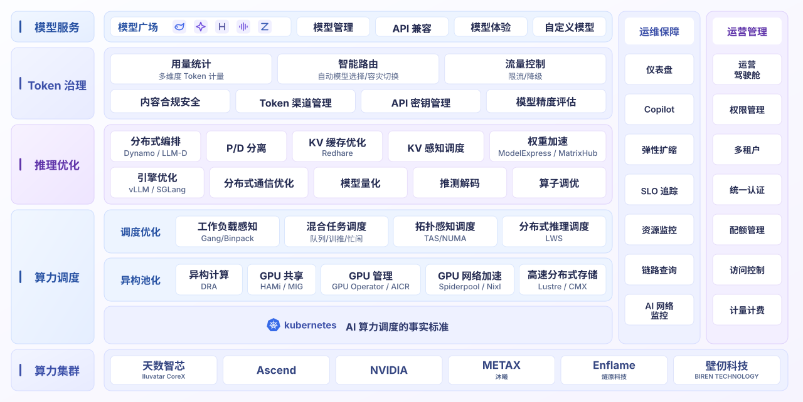
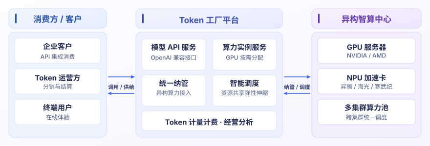
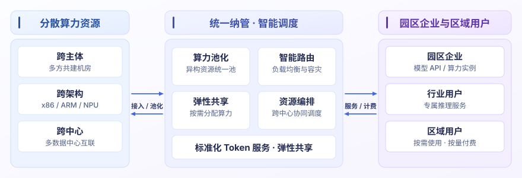
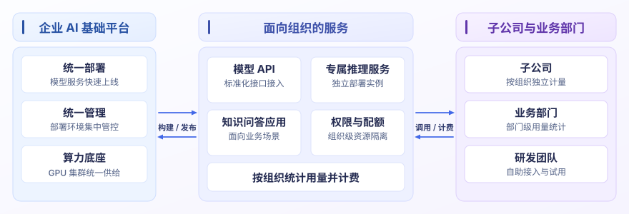

---
hide:
  - toc
---

# Token 工厂效能平台

**d.run Token 工厂效能平台** 是专为智算中心打造的 AI Token 生产及经营系统，面向智算中心与算力持有方，通过统一纳管异构算力、智能调度与全栈推理优化，将分散的 GPU 算力转化为高效、稳定、可计量、可运营的标准化 Token 服务。

平台围绕 Token 生产提效与运营管理，通过推理引擎优化、P/D 分离、KV Cache 管理、智能路由与算子调优持续提升 Token 产出效率，并依托统一纳管与智能调度实现异构算力的高效利用和弹性共享；同时提供 Token 计量计费、运营驾驶舱与经营分析能力，帮助智算中心从“提供算力”升级为“生产和运营 Token”，实现算力价值转化，打造高效、可持续、可盈利的 Token 工厂。

Token 工厂以异构算力集群为底座，基于 Kubernetes 统一管理和调度 GPU 资源，通过 P/D 分离、KV Cache 优化和分布式编排提升模型推理效率。平台向上提供模型部署、管理与 API 接入能力，并通过用量统计、智能路由和流量控制实现 Token 治理。同时提供运维保障与运营管理能力，覆盖服务 SLO 跟踪、资源监控、弹性扩缩、权限配额和计量计费等，保障 Token 工厂的高效稳定运行。

## 适用场景

=== "智算中心运营"

    基于 GPU 集群提供模型 API 和算力实例服务，统一管理服务供给、客户消费、费用结算及经营情况。

    

=== "园区与区域 Token 服务"

    统一纳管/调度区域内跨主体、跨架构、跨中心的算力资源，转化为标准 Token 服务，为园区企业及区域用户提供按需使用、按量付费的模型服务。

    

=== "大型企业 AI 服务建设"

    统一部署和管理模型服务，面向各子公司和业务部门提供模型 API、专属推理服务和知识问答应用，支持按组织统计用量并计费。

    

## 产品优势

| 产品优势 | 说明 |
| :--- | :--- |
| 高效的 Token 生产 | 结合异构 GPU 调度、资源共享和推理优化，提升有效 Token 吞吐和算力利用率，降低单位 Token 成本 |
| 快速交付模型服务 | 统一管理模型与部署环境，通过优选部署模板加快模型上线，并借助标准模型接口和 AI 应用缩短业务接入时间 |
| 全链路运行保障 | 持续监测推理性能和 GPU 资源，关联日志、调用链路与运行事件，帮助运维团队及时发现异常、快速定位故障 |
| 精细化 Token 经营 | 统一管理用量计量、消费计费和账户资金，结合产能、客户用量、收入与成本分析，为预算分配和经营决策提供依据 |
