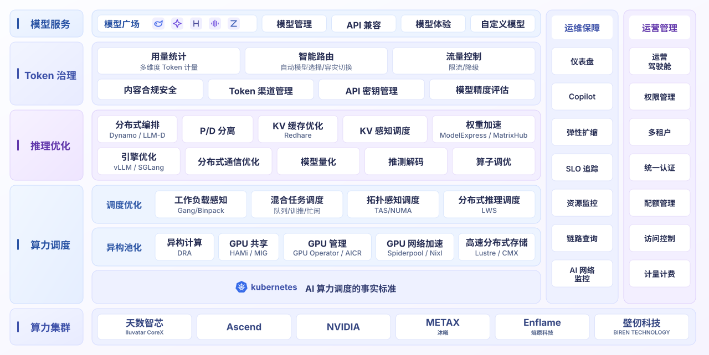

# Token 工厂效能平台产品介绍

## 产品概述

### 产品定位

**d.run Token 工厂效能平台**是专为智算中心打造的 AI Token 生产及经营系统，面向智算中心与算力持有方，通过统一纳管异构算力、智能调度与全栈推理优化，将分散的 GPU 算力转化为高效、稳定、可计量、可运营的标准化 Token 服务。

平台围绕 Token 生产提效与运营管理，通过推理引擎优化、P/D 分离、KV Cache 管理、智能路由与算子调优持续提升 Token 产出效率，并依托统一纳管与智能调度实现异构算力的高效利用和弹性共享；同时提供 Token 计量计费、运营驾驶舱与经营分析能力，帮助智算中心从“提供算力”升级为“生产和运营 Token”，实现算力价值转化，打造高效、可持续、可盈利的 Token 工厂。

### 适用场景

- **智算中心运营**：基于 GPU 集群提供模型 API 和算力实例服务，统一管理服务供给、客户消费、费用结算及经营情况。

- **企业 AI 服务建设**：集中部署和管理模型，为不同子公司或部门提供模型 API 调用、专属推理服务及知识问答应用，并按组织计量计费。

- **园区与区域 Token 服务**：统一纳管和调度区域内跨主体、跨架构、跨中心的算力资源，将算力转化为标准化 Token 服务，为园区企业及区域用户提供按需使用、按量付费的模型服务。

### 产品优势

- **高效的 Token 生产**。结合异构 GPU 调度、资源共享和推理优化，提升有效 Token 吞吐和算力利用率，降低单位 Token 成本。

- **快速交付模型服务**。统一管理模型与部署环境，通过优选部署模板加快模型上线，并借助标准模型接口和 AI 应用缩短业务接入时间。

- **全链路运行保障**。持续监测推理性能和 GPU 资源，关联日志、调用链路与运行事件，帮助运维团队及时发现异常、快速定位故障。

- **精细化 Token 经营**。统一管理用量计量、消费计费和账户资金，结合产能、客户用量、收入与成本分析，为预算分配和经营决策提供依据。

## 核心模块与视图

### 核心架构

Token Factory 以异构算力集群为底座，基于 Kubernetes 统一管理和调度 GPU 资源，通过 P/D 分离、KV Cache 优化和分布式编排提升模型推理效率。平台向上提供模型部署、管理与 API 接入能力，并通过用量统计、智能路由和流量控制实现 Token 治理。同时提供运维保障与运营管理能力，覆盖服务 SLO 跟踪、资源监控、弹性扩缩、权限配额和计量计费等，保障 Token 工厂的高效稳定运行。

### 用户与管理视图

平台围绕 Token 工厂生产运营，根据使用职责提供相应的操作入口和数据视图，支持业务使用、服务管理、生产运维和经营分析等工作。

- **业务用户**：选择和调用模型、部署专属服务、使用 AI 应用及 GPU 实例，并查询自身用量和消费。

- **服务管理员**：管理模型上架、服务接入、调用规则、用户权限和组织资源范围。

- **运维人员**：管理基础设施与资源调度，监测推理服务性能，处理告警和运行故障。

- **经营人员**：分析产能、客户消费、收入成本和资金使用情况，开展预算管理与投资测算。

## 云原生 AI

### 模型服务

用户可在授权范围内使用平台 MaaS 服务，也可以部署专属模型服务。

- **模型选型与体验**：在模型广场查找文本生成、图片理解、图像生成等模型，选择适合业务的模型。通过在线试用和对比多个模型，在接入业务前检查回答效果。

- **模型部署**：将主流开源、自研的模型部署为专属推理服务，并查看服务运行状态。支持采用多机多卡的分布式部署。

- **API 接入**：提供 OpenAI 兼容 API 和调用示例，支持 Cherry Studio、Cline、LobeChat、Bob 等客户端，方便业务系统和开发工具调用模型。

- **API Key 管理**：创建和管理调用密钥，控制应用对模型服务的访问权限。

- **用量统计**：按模型、API Key 和时间查看调用与 Token 消耗，了解各应用的使用情况，为预算管理和应用调整提供依据。

### 模型管理与 Token 治理

支持管理员模型上下架、调用规则管理，维护 AI 网关配置，保障模型服务稳定运行。

- **模型上下架**：支持模型导入、创建、发布和下线，管理向用户开放的模型目录。

- **MaaS 服务接入**：接入自建服务或上游模型 API，由平台统一向用户提供调用入口。

- **智能路由**：通过路由、负载均衡和备用路径分配请求，提高服务可用性。

- **调用限流**：支持全局、租户和 API Key 等层级的流量限制，减少突发请求对共享服务的影响。

- **内容安全**：通过敏感词检测、正则匹配、接入安全模型等内容策略，管理模型调用中的内容风险。

- **分析中心**：按模型、租户统计输入和输出 Token 用量，分析收入、成本及毛利的变化趋势。

### 推理加速服务

推理加速服务通过优化模型部署架构、推理引擎、缓存复用等，提高模型的运行效率。让模型服务在满足响应时间和稳定性要求的前提下，提高有效 Token 吞吐、降低单位成本。

- **高性能模型部署**：在 NVIDIA及多种国产算力上结合主流推理框架部署高性能推理服务，支持多机多卡和 P/D 分离，按预填充与解码的不同特点规划资源。

- **KV 缓存复用**：通过 KV Cache 卸载及 Redhare 分层缓存复用重复前缀计算，结合本地与远端内存、存储资源扩大缓存空间，减少长上下文和多轮任务中的重复计算。

- **优选模板库**：围绕 vLLM、SGLang 及 LLM\-D、Dynamo 等主流推理引擎分布式编排框架，提供丰富的优选部署模板，缓解吞吐、显存及延迟瓶颈。

- **模型验收测试**：上线前验证模型 API 兼容性、功能与性能，使优化结果同时满足模型效果和服务质量要求，作为上线服务标准。

- **服务观测**：关联服务吞吐、P/D 队列、缓存命中、GPU 和网络指标，区分请求增长、计算不足、缓存及通信问题，为持续性模型性能优化与排障提供依据。

### 算力云

算力云提供可按需使用的 GPU 容器实例。用户可以选择资源规格和付费方式，快速准备开发、实验或推理环境。算力市场汇集不同供应方的 GPU 资源，实际可选规格以部署环境和库存为准。

- **付费方式**：支持按量付费或包年包月，分别满足短期实验和长期运行需要。

- **实例管理**：根据 GPU 需求选择实例规格创建实例，按任务需要管理运行资源。

- **开发访问**：通过 JupyterLab、SSH 或 VS Code 访问实例，进行代码调试、算法实验和服务部署。

### AI 应用

AI 应用基于检索增强生成（RAG），结合企业文档、FAQ 等资料生成回答，支持构建客服、咨询和内部知识问答应用。

- **知识问答**：结合企业知识和对话上下文回答问题，支持回答评价与反馈。

- **应用接入**：通过应用链接、H5 页面使用服务，或通过 OpenAPI 接入业务系统。

## 云原生底座

云原生底座基于 Kubernetes，为模型服务、推理加速和 AI 应用提供统一的运行环境，支持异构 GPU 调度与共享，并提供集群、网络、存储、镜像及设备管理能力。

### GPU 资源与调度

- **异构 GPU 纳管**：统一识别和管理 NVIDIA GPU 及昇腾等国产 AI 加速设备，支持在同一集群中管理和调度不同卡型，适应多种硬件并存的算力环境。

- **GPU 共享**：支持整卡、vGPU、MIG 等资源使用方式。在适用硬件上按显存或算力分配额度，让多个任务共享 GPU，减少资源闲置。

- **AI 任务与服务调度**：结合任务的 GPU 需求和节点拓扑分配资源，支持 Gang 调度、拓扑感知调度等调度模式，支持多节点推理，满足不同规模模型的运行需求。

### 网络与存储

- **容器网络**：通过多 CNI、Multus、SpiderPool 等组件配置网络，使用 IP 池管理地址分配。

- **高性能通信**：通过相应 RDMA 配置，满足 AI 任务对低延迟、高带宽通信的需求。

- **持久化存储**：通过 CSI 接入已有存储或云原生本地存储，为模型文件、数据集和有状态服务提供持久化卷。

## 运营管理

### 驾驶舱

驾驶舱汇总平台计量、账单和监控数据，展示 GPU 资源、Token 产出、客户消费及收入成本，为经营分析和生产管理提供依据。经营人员可实时分析客户、收入和成本等经营情况。

- **产能与计费转化分析**：对比可供给产能、实际产出和计费 Token，分析算力利用情况及产出向计费消费的转化。

- **客户与模型分析**：结合客户用量、收入贡献、消费集中度和模型排行，分析消费结构及不同模型的经营表现。

- **成本效率比较**：比较不同 GPU 型号的利用率、单卡产出和单位 Token 成本，评估资源和模型的运行效率。收益分析需使用完整的成本与消费数据。

- **生产状态分析**：查看吞吐、首 Token 延迟（TTFT）、每 Token 生成延迟（TPOT）、队列、GPU 池和 SLA。结合告警、调度及扩缩容事件，分析指标变化的原因。

### Copilot 智能工作台

Copilot 智能工作台支持通过自然语言查询平台数据、分析业务问题，并调用已接入的工具执行任务。经营人员可查询产能、消费及投资回收情况，运维人员可分析资源与服务状态。

- **平台信息查询**：结合资源、服务、监控和消费数据回答问题，减少人工切换页面、收集信息的工作。

- **问题分析**：针对容量、性能、成本和运行异常分析可能原因，比较处理方案，列出还需核实的条件。

- **投资测算**：根据设备、吞吐、价格、负载和成本，计算年收入、净现金流及静态回本期，比较不同经营条件，并保留假设和数据来源。

### 费用中心

费用中心统一管理模型与算力服务的消费计费、优惠抵扣及账户资金，支持企业通过主子账号分配资金、控制预算和核对账单。支持主账号充值、额度分配及月度对账，子账号查询自身消费记录，并在分配额度内使用服务。

- **计费与订单**：按商品用量和规则计费，支持按量或周期付费，区分普通输入、输出和缓存 Token；记录服务购买及资源变更。

- **账单与收支**：支持按账号、产品、区域和账期汇总、筛选及导出账单，记录余额变化，方便消费对账与资金核对。

- **账户与额度**：支持账户充值、余额提醒和主子账号资金共享，可为子账号分配使用额度，控制预算。

- **优惠与奖励**：按活动规则记录邀请进度、发放代金券，并按有效期和适用范围抵扣消费，不足部分扣除现金余额。

## 运维管理

### 可观测性

可观测性围绕推理服务的运行状态，统一采集指标、日志、分布式链路和事件，帮助运维人员分析请求响应、服务吞吐和 GPU 资源使用情况，定位推理性能瓶颈与运行故障。

- **推理性能监测**：关注请求吞吐、首 Token 延迟（TTFT）、每 Token 生成延迟（TPOT）和请求错误，了解服务响应速度及稳定性。

- **GPU 资源监测**：结合 GPU 利用率、显存占用及节点资源，分析推理负载与资源使用情况，为容量调整和性能优化提供依据。

- **推理故障定位**：关联请求链路、服务日志、资源指标和运行事件，排查请求变慢、调用失败及服务异常的原因。

- **告警管理**：针对服务延迟、错误及资源异常提供告警和通知，提醒运维人员及时处理服务故障。

### 全局管理

全局管理统一管理身份、权限和资源范围，让不同团队能够共享平台，并清楚界定各自可访问的数据与资源。

- **身份与权限管理**：支持本地账号及 LDAP、OIDC、OAuth 2\.0 等外部身份源，通过用户组、角色和工作空间分配权限，隔离不同用户的资源。

- **平台治理与设置**：记录关键操作，支持安全审计与责任追溯，统一配置会话、密码策略、通知服务及平台外观。
