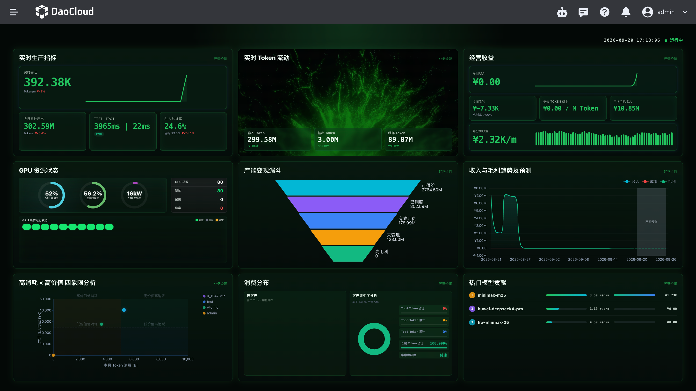
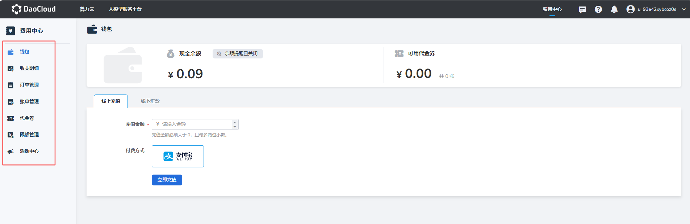
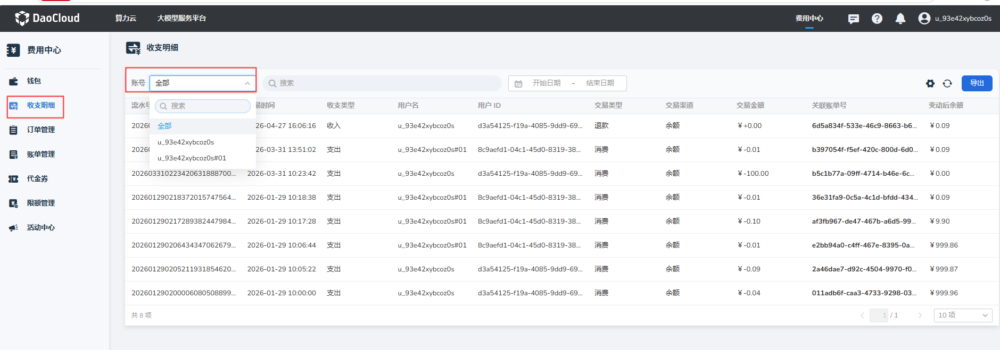

# 运营与计费 - 用户

模型跑起来之后，运营者最关心两件事：平台经营状况如何、Token 消耗怎么计费。
本教程带您用[驾驶舱](../crane/intro/index.md)查看运营数据，在[费用中心](../leopard/index.md)管理钱包与账单。

## 前提条件

- 已完成[部署模型服务](deploy-model.md)或[模型调用](call-model.md)，平台已产生真实的 Token 消耗。
- 使用具有驾驶舱和费用中心权限的用户登录控制台。

## 查看驾驶舱

1. 在产品导航中打开 **驾驶舱**，默认进入[经营概览面板](../crane/user-guide/singlepage.md)。

2. 在经营概览中查看收入、成本、毛利、产能变现与客户消费结构等核心指标，
   掌握算力产能、Token 产出与生产健康状态。

    

3. 需要查看部门配额消耗与组织用量分布时，切换到企业模式视图；
   需要复盘经营状况时，切换到运营模式视图。

## 管理钱包与账单

1. 在产品导航中打开 **费用中心**，进入[钱包](../leopard/index.md)页面，查看现金余额与代金券。

    {width=900px}

2. 通过[线上充值](../leopard/index.md)或线下汇款为钱包充值；充值金额只有在消费后才可开具发票。

3. 在[收支明细](../leopard/transactions.md)中按需查看充值与支付记录。

    {width=900px}

4. 在[账单](../leopard/bills.md)中按模块和时间维度查看 Token 与资源消耗的计量结果，核对模型调用的费用。

## 验证结果

驾驶舱中能看到与实际调用对应的 Token 产出与消费数据，费用中心账单中能查到对应的计量记录，即表示运营与计费链路贯通。

## 下一步

了解运营指标与计费规则的更多内容，参阅[运营驾驶舱](../crane/intro/index.md)与[费用中心](../leopard/index.md)。
