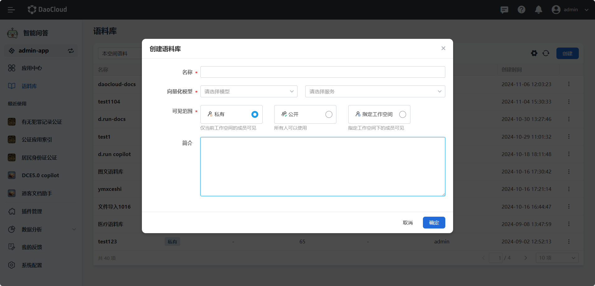
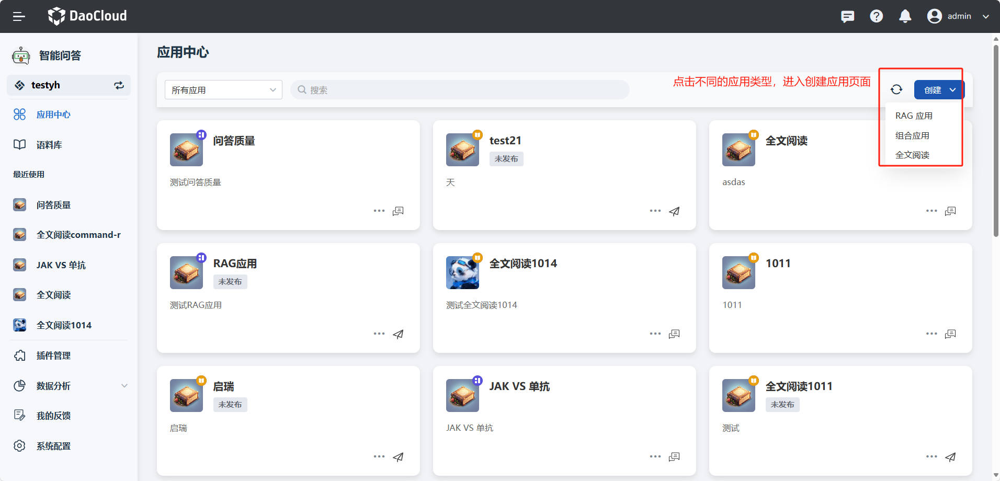
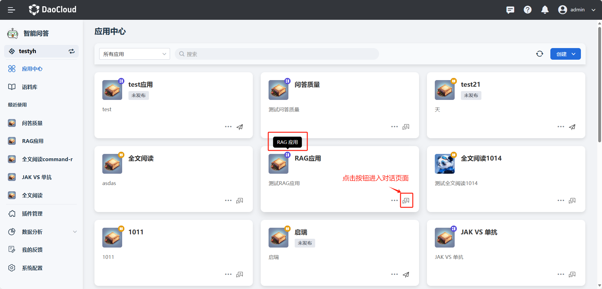

# 构建智能应用 - 用户

本教程在 [AI 应用](../dak/index.md)中搭建语料库并创建一个 RAG 智能问答应用，让模型基于您的私有知识回答问题。

## 前提条件

- 已用具有 AI 应用模块权限的用户登录控制台。
- 已准备好一份业务文档（如 FAQ、产品手册），格式为文本或问答对。

## 操作步骤

1. 在左侧导航栏点击 **AI 应用** -> **我的语料**，点击 **创建语料**。

2. 填写语料库基本信息，点击 **下一步**：

    

    - **语料库名称**：大小写字母、数字和符号，最多 20 个字符。
    - **向量化模型服务**：选择 `bge-large-zh` 或 `bge-large-en`。
    - **可见范围**：公开、私有或指定工作空间。
    - **简介**：最多 100 个字符。

3. 按向导上传语料：选择本地文件或在线数据导入，确认后系统自动解析并切分为知识块，
   处理完成后可在语料库详情中查看知识块质量与命中情况。

4. 在左侧导航栏点击 **应用中心**，点击 **创建**，选择创建 **RAG 应用**。

    

5. 填写应用基础信息：上传应用图标（jpg/jpeg/png，不超过 10MB）、应用名称（20 字符以内）、应用简介（100 字符以内）。

6. 在 AI 配置中选择大语言模型服务（选择[部署的模型服务](deploy-model.md)或在线模型）、向量化模型和系统提示词，其余参数保持默认。

7. 关联上一步创建的语料库，点击 **确定** 完成创建。

8. 进入应用对话页面，围绕语料内容提问，验证回答是否基于您的知识库生成。

    

## 验证结果

对话界面回答内容引用了语料库中的知识块，且开启应用调试时可以看到检索命中的语料，即表示 RAG 应用搭建成功。

## 下一步

把应用投入使用后，参阅[运营与计费](billing.md)；了解语料库与应用的完整用法，参阅[AI 应用](../dak/index.md)。
