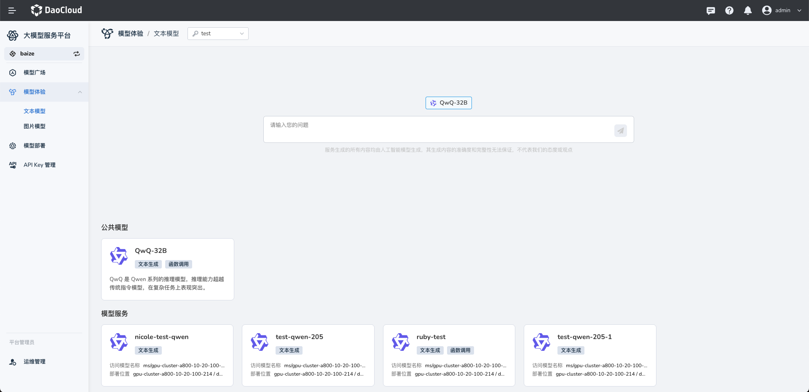
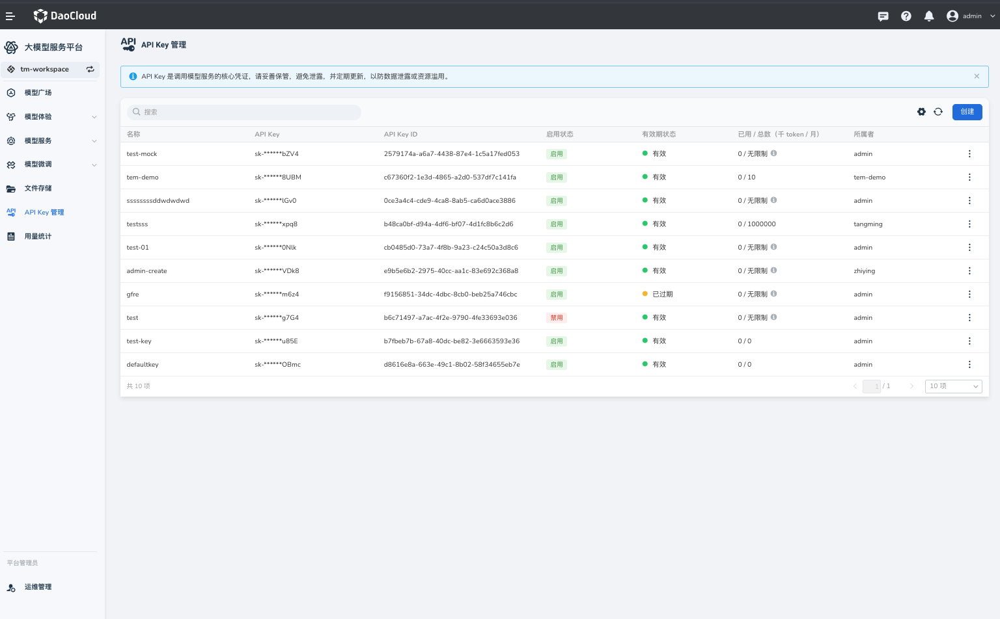

# 体验与调用模型 - 用户

部署或选用平台预置模型后，您可以通过两种方式使用模型：在 **模型体验** 中在线对话，或创建 API Key 后通过 OpenAI 兼容接口调用。

## 前提条件

- 已用具有大模型服务平台权限的用户登录控制台。
- 已有可用的模型：平台预置的公共模型，或[已部署的模型服务](deploy-model.md)。

## 在线体验

1. 在左侧导航栏点击 **模型体验**，选择模型类型（文本模型或图片模型）。

    也可以在[模型广场](../hydra/index.md)中直接点击目标模型的 **体验** 按钮进入体验页面。

2. 在体验中心选择模型：公共模型可直接体验；已部署的模型服务可从 **模型服务** 列表中挑选。

3. 在对话框输入问题，即可与大模型对话，直观感受其能力。

    

## 创建 API Key

1. 在左侧导航栏点击 **API Key 管理**，点击右上角的 **创建**。

    

2. 填写 API Key 名称（如 `test-key`），点击 **确定** 生成新的 API Key。

    !!! note

        API Key 只在首次创建时完整显示，请立即保存。若泄露，请及时删除并重新生成。

## 通过 API 调用模型

使用 OpenAI 兼容接口调用，以 Python 为例：

=== "MaaS by Token（共享资源，按 Token 计费）"

    ```python
    import openai

    openai.api_key = "your-api-key" # 替换为您的 API Key
    openai.api_base = "https://chat.d.run"

    response = openai.Completion.create(
      model="public/deepseek-r1",
      prompt="What is your name?"
    )

    print(response.choices[0].text)
    ```

=== "独立模型服务（独享实例）"

    ```python
    import openai

    openai.api_key = "your-api-key" # 替换为您的 API Key
    openai.api_base = "https://sh-02.d.run" # 替换为您的模型服务所在的区域

    response = openai.Completion.create(
      model="u-1100a15812cc/qwen2", # 替换为您的模型服务访问名称
      prompt="What is your name?"
    )

    print(response.choices[0].text)
    ```

## 验证结果

在线体验能正常返回对话内容，或 API 调用返回模型生成的文本，即表示模型可用。

## 下一步

将模型接入智能问答应用，参阅[构建智能问答应用](build-app.md)；了解调用方式与客户端接入，参阅[模型调用](../hydra/api-call.md)。
