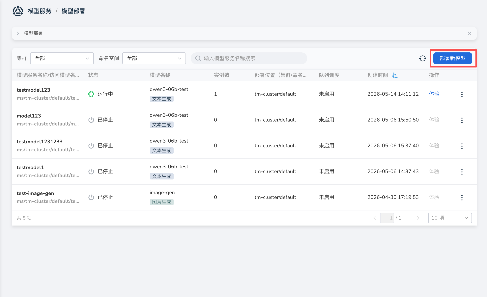
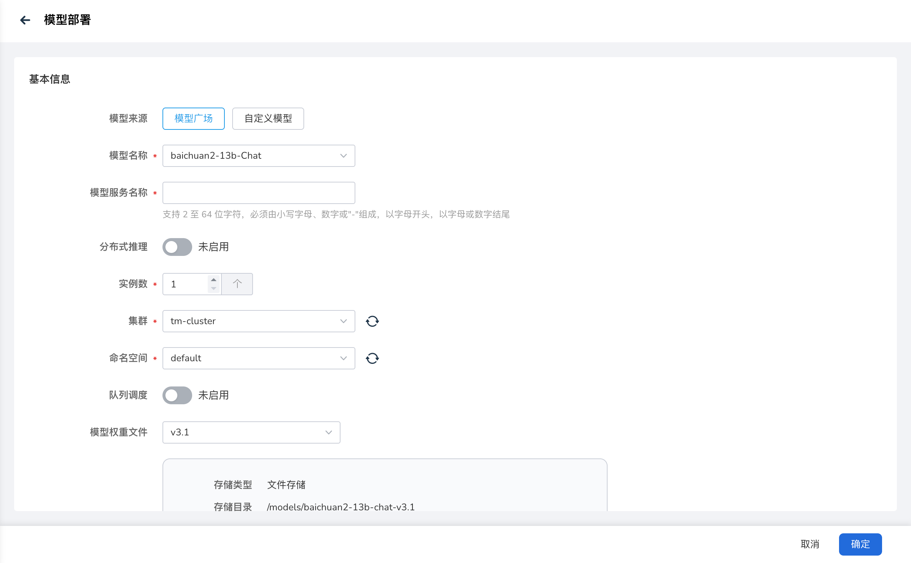

# 部署模型服务 - 用户

本教程在[大模型服务平台](../hydra/intro/index.md)中把模型广场里的模型部署为可调用的推理服务。

## 前提条件

- 已创建工作集群，集群与命名空间可用，参见[创建工作集群](join-cluster.md)。
- 已用具有大模型服务平台权限的用户登录控制台。

## 操作步骤

1. 在左侧导航栏点击 **大模型服务平台**，进入 **模型广场**。

2. 浏览或搜索目标模型（如 DeepSeek-R1），点击模型卡片上的 **部署** 按钮，进入部署页面。

    

3. 按需填写部署参数，点击 **确定**：

    | 参数项 | 说明 |
    |---|---|
    | 模型选择 | 从模型广场或自定义模型中选择，如 DeepSeek-R1 |
    | 模型服务名称 | 小写字母、数字和短横线（`-`），2–64 个字符，如 `text-gen-service` |
    | 实例数 | 实例越多并发能力越强、成本越高，默认 1 |
    | 部署集群 | 选择[创建的工作集群](join-cluster.md)，建议选择 GPU 节点所在的集群 |
    | 命名空间 | 与集群绑定的目标命名空间 |
    | 运行时框架 | 根据模型与场景选择推理运行时 |

    剩余参数（分布式推理、队列调度等）保持默认即可满足快速体验。

    

4. 部署完成后，在左侧导航 **模型服务** 列表中查看服务状态从 **部署中** 变为 **运行中**。

## 验证结果

模型服务状态为 **运行中** 后，可在[模型体验](call-model.md)中选择该服务直接对话，或通过 API 调用验证服务可用。

## 下一步

在线对话体验或通过 API 调用模型，参阅[体验与调用模型](call-model.md)；了解模型服务的管理与扩缩容，参阅[模型服务](../hydra/deploy/index.md)。
