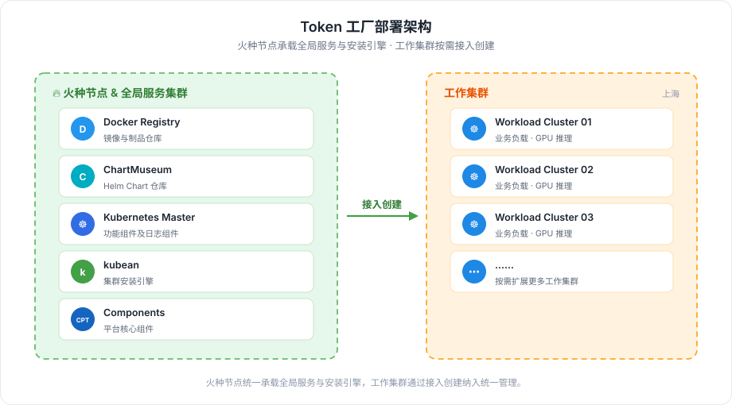

# 安装部署 Token 工厂 - 管理员

本教程带您在离线环境中完成 Token 工厂的安装，并用默认账号登录控制台。

## 前提条件 {: #prereq }

- 一台满足[部署要求](../install/commercial/deploy-requirements.md)的机器作为火种节点，已开启 IPv4 转发、禁用防火墙。
- 已下载[离线镜像包](../install/start-install.md)（如 `offline-v0.46.0-amd64.tar`）并上传到火种节点。
- 已按火种节点的操作系统下载对应的 osPackage 离线包。



## 操作步骤

1. 在火种节点解压离线镜像包：

    ```bash
    tar -xvf offline-v0.46.0-amd64.tar
    ```

2. 编辑解压后 `offline/sample` 目录下的 [clusterConfig.yaml](../install/commercial/cluster-config.md)，
   配置部署模式、集群节点与 ISO 镜像路径；如需调整要安装的模块，编辑 [manifest-cloud-tokfact.yaml](../install/commercial/manifest.md)。

3. 执行以下命令开始安装：

    ```bash
    ./offline/dce5-installer cluster-create \
      -c ./offline/sample/clusterConfig.yaml \
      -m ./offline/sample/manifest-cloud-tokfact.yaml
    ```

    !!! note

        - `-c` 指定集群配置文件，必选
        - `-m` 指定产品清单；Token 工厂请使用 `manifest-cloud-tokfact.yaml`
        - `-z` 最小化安装
        - `-d` 开启 debug 模式

    安装耗时约 30 分钟，取决于节点数量与网络环境。

4. 安装完成后，命令行会提示安装成功。通过屏幕提示的 URL 访问控制台，使用默认账号和密码 `admin/changeme` 登录。

5. 联系 DaoCloud 申请授权：电邮 info@daocloud.io 或致电 400 002 6898。授权后进入控制台首页确认各模块状态正常。

## 验证结果

使用 `admin` 登录控制台，在左侧导航中可以看到全局管理、容器管理、大模型服务平台等模块入口，即表示安装成功。

## 下一步

安装完成后，继续[创建用户与工作空间](init-users.md)。

了解安装的完整流程与配置说明，参阅[安装指南](../install/index.md)；如遇问题，参阅[安装排障](../install/faq.md)。
