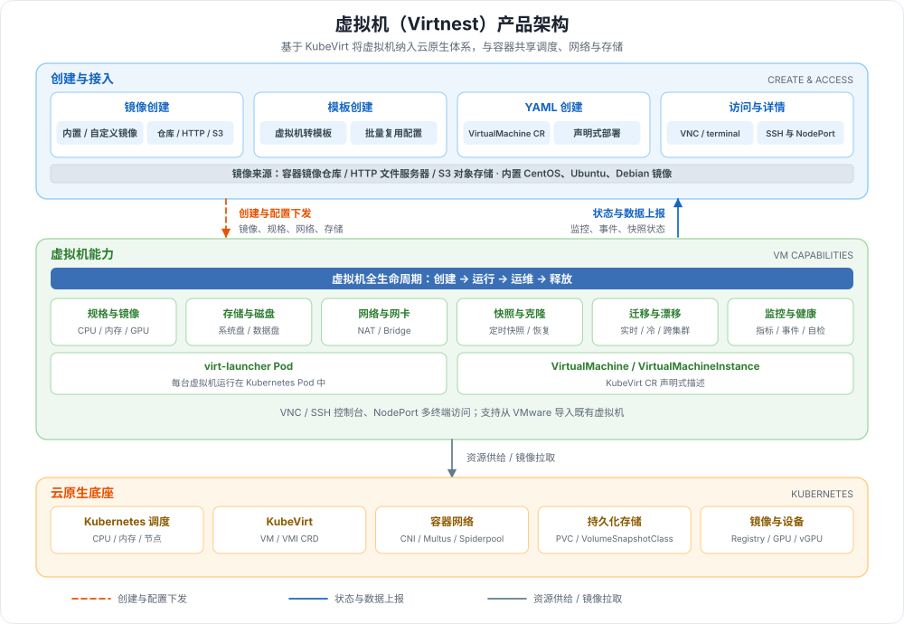

---
hide:
  - toc
---

# 什么是虚拟机 (Virtnest)

虚拟机（Virtnest）基于 KubeVirt 将虚拟机作为云原生应用统一管理，让虚拟机与容器共享同一套 Kubernetes 调度、网络、存储与镜像体系。用户可以通过镜像、模板或 YAML 快速创建虚拟机，使用 VNC / SSH 登录，并在同一平台完成启停重启、规格调整、快照克隆、迁移与监控等日常运维，适用于传统应用上云、VMware 虚拟机迁移、开发测试环境以及 GPU 算力等场景。

!!! note

    虚拟机 Virtnest 是 DCE 商业版（标准版、高级版和白金版）专用的特性。

## 产品架构

架构自上而下分为创建与接入、虚拟机能力、云原生底座三层：

| 层面 | 组件 | 职责 | 图中标识 |
| --- | --- | --- | --- |
| **创建与接入** | 镜像 / 模板 / YAML 创建 | 提供三种创建方式；支持 VNC、SSH 与 NodePort 多终端访问，以及虚拟机详情查看 | 蓝色区域 |
| **创建与接入** | 虚拟机镜像 | 支持容器镜像仓库、HTTP 文件服务器与 S3 对象存储；内置 CentOS、Ubuntu、Debian 镜像 | 蓝色横条 |
| **虚拟机能力** | 生命周期与运维 | 启停重启、规格调整、快照与定时快照、克隆、实时 / 冷 / 跨集群迁移、监控与健康检查 | 绿色区域 |
| **虚拟机能力** | 规格、网络与存储 | 支持 CPU / 内存热加载与 Nvidia GPU / vGPU；Masquerade（NAT）与 Bridge（桥接）网络；系统盘、数据盘与 PVC | 绿色小卡 |
| **云原生底座** | KubeVirt + Kubernetes | 以 VirtualMachine / VMI 描述虚拟机，由 virt-launcher Pod 承载，复用集群调度、CNI、存储与镜像能力 | 橙色区域 |

## 核心能力

Virtnest 围绕虚拟机的创建、运行与运维提供完整能力。相比单独维护一套虚拟化平台，它复用 Kubernetes 的调度、镜像与网络体系：以容器镜像为创建基础并共享主机内核与硬件资源，提升资源利用率；镜像化分发缩短虚拟机启动时间，支持按需快速部署与扩容；启停、配置与监控沿用集群管理工具，简化日常操作；应用及其配置可打包进镜像灵活发布，并直接复用容器网络、服务发现与负载均衡，与既有容器化应用无缝协作。

-   :material-cube-outline:{ .lg .middle } __云原生虚拟机__

    ---

    基于 KubeVirt 将虚拟机作为云原生应用管理，与容器共享 Kubernetes 调度、服务发现与网络能力，降低虚拟化与容器化并存的管理成本。

    [:arrow_forward: 功能特性](features.md)

-   :material-view-grid-outline:{ .lg .middle } __三种创建方式__

    ---

    支持通过镜像、模板与 YAML 创建虚拟机；镜像可来自容器镜像仓库、HTTP 文件服务器或 S3 对象存储，并可自定义镜像。

    [:arrow_forward: 创建虚拟机](../quickstart/index.md)

-   :material-file-image-outline:{ .lg .middle } __镜像与模板__

    ---

    内置 CentOS、Ubuntu、Debian 镜像，也可构建自定义镜像；支持将已有虚拟机转换为模板，批量复用配置。

    [:arrow_forward: 虚拟机镜像](../vm-image/index.md)

-   :material-content-save-move:{ .lg .middle } __快照、克隆与迁移__

    ---

    支持快照与定时快照、虚拟机克隆，以及实时迁移、冷迁移、跨集群迁移与节点自动漂移。

    [:arrow_forward: 快照管理](../vm/snapshot.md)

-   :material-access-point-network:{ .lg .middle } __网络与存储__

    ---

    支持 Masquerade（NAT）与 Bridge（桥接）网络、多网卡与固定 IP；基于 PVC 提供系统盘、数据盘加载与扩容能力。

    [:arrow_forward: 虚拟机网络](../vm/vm-network.md)

-   :material-monitor-eye:{ .lg .middle } __GPU 与可观测__

    ---

    支持 Nvidia GPU / vGPU 直通，提供监控指标、事件、健康检查与控制台访问，便于掌握虚拟机运行状态。

    [:arrow_forward: 虚拟机 GPU](../gpu/vm-gpu.md)

## 学习路径

按下面的顺序依次完成，即可从零开始创建并运维一台虚拟机：

  <a class="vn-path-step" style="--path-c:#2196f3" href="../install/">
    1
    安装部署
    安装虚拟机模块与 virtnest-agent
    前往 →
  </a>
  <a class="vn-path-step" style="--path-c:#00acc1" href="../vm-image/">
    2
    准备镜像
    构建或导入虚拟机镜像
    前往 →
  </a>
  <a class="vn-path-step" style="--path-c:#43a047" href="../quickstart/">
    3
    创建虚拟机
    通过镜像、模板或 YAML 创建
    前往 →
  </a>
  <a class="vn-path-step" style="--path-c:#fb8c00" href="../quickstart/access/">
    4
    连接虚拟机
    VNC / 终端登录，查看详情
    前往 →
  </a>
  <a class="vn-path-step" style="--path-c:#8e24aa" href="features/">
    5
    日常运维
    快照、克隆、迁移与监控
    前往 →
  </a>

[下载中心](https://docs.daocloud.io/download/){ .md-button }
[了解 Token 工厂效能平台](https://docs.daocloud.io/tf/){ .md-button }
[了解 d.run AI 操作系统](https://docs.daocloud.io/drun/){ .md-button }
[查阅《虚拟机用户手册》PDF](https://harbor-test2.cn-sh2.ufileos.com/docs/download/docs/virtnest.pdf){ .md-button }
